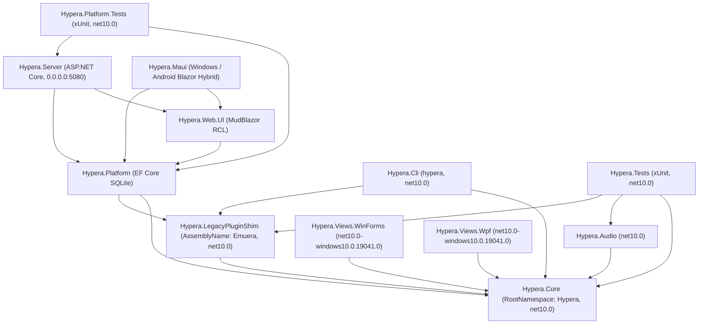

# Hypera 引擎架构指南

`Hypera` 是面向 `.NET 10` 从零构建的现代化、跨平台、100% 实例隔离的 Emuera（eramaker 派生脚本）编译与运行时引擎。它既可作为桌面端（WinForms / WPF）与命令行（`hypera` CLI）的独立执行内核，也可作为高并发多租户 Web 宿主（如 CloudEmuera）的嵌入式无阻塞虚拟机。

---

## 1. 核心架构原则与模块边界

### 1.1 设计铁律
1. **零全局可变状态（Zero `GlobalStatic`）**：严禁使用任何 `static` 可变字段保存配置、变量表、角色列表、控制台缓冲、随机数状态或图像/音频句柄。所有运行期状态100%隶属于具体的 `EmueraEngine` 实例；编译产物 `BytecodeModule` 完全不可变，可在成百上千个并发 `EmueraEngine` 实例间零拷贝共享。
2. **严格编译期校验（Strict AOT/JIT-Ready Compilation）**：所有词法、语法、符号解析与静态类型错误必须在编译阶段通过 `DiagnosticBag` 收集并抛出 `EmueraCompileException`，绝不允许像传统解释器那样把损坏的语句推迟到玩家运行对应分支时才崩溃。仅 `PRINTFORMS`、`STRFORM`、`RETURNFORM`、`GETVAR`/`SETVAR` 等显式动态语义走受控的 `DynamicEval*` 操作码。
3. **无栈协程挂起（Stackless VM Suspension）**：遇到 `INPUT`、`ONEINPUT`、`WAIT`、`TINPUT`、`AWAIT` 等指令时，虚拟机**绝不阻塞操作系统线程**，而是将当前程序计数器（PC）与寄存器现场保留在显式堆分配的 `CallFrame` 栈中，立即向宿主返回 `EngineStepStatus.WaitingInput` 或 `Yielded`。
4. **权威逻辑视口（Authoritative Logical Viewport）**：脚本排版、精灵绘制与鼠标点击命中测试全部在游戏配置定义的逻辑像素坐标系（`WindowX × WindowY`）内完成，与宿主显示器物理分辨率及系统 DPI 缩放完全解耦。

### 1.2 解决方案拓扑（`Hypera.slnx`）

| 项目路径 | 目标框架 / 程序集名 | 职责边界 |
| --- | --- | --- |
| `src/Hypera.Core` | `net10.0` (`Hypera.Core.dll`) | 核心契约与基础设施：`Hypera.VirtualFs`、`Hypera.Diagnostics`、`Hypera.Localization`、`Hypera.Configuration`、`Hypera.Bytecode`、`Hypera.Runtime`、`Hypera.Rendering`、`Hypera.Audio` |
| `src/Hypera.Audio` | `net10.0` (`Hypera.Audio.dll`) | 跨平台 10 路音效（SE `0..9`）+ 1 路循环背景音乐（BGM）软件混音器 `CrossPlatformAudioMixer` |
| `src/Hypera.LegacyPluginShim` | `net10.0` (**`Emuera.dll`**) | 兼容旧版 `CALLSHARP` 插件的 `MinorShift.Emuera.Runtime.Utils.PluginSystem` 二进制垫片，基于可回收 `AssemblyLoadContext` 与 `AsyncLocal` 引擎作用域绑定 |
| `src/Hypera.Views.WinForms` | `net10.0-windows10.0.19041.0` | 超薄 `SKControl` 宿主控件 `HyperaSkiaControl`，转发绘制与逻辑视口鼠标坐标 |
| `src/Hypera.Views.Wpf` | `net10.0-windows10.0.19041.0` | 超薄 `SKElement` 宿主控件 `HyperaSkiaElement`，处理 WPF DPI 换算并转发逻辑视口输入 |
| `src/Hypera.Cli` | `net10.0` (**`hypera`**) | 命令行入口，承载 `run`、`compile`、`pack`、`bundle` 四大子命令 |
| `src/Hypera.Platform` | `net10.0` (`Hypera.Platform.dll`) | 多租户/本地共用平台服务层：SQLite WAL 持久化、鉴权与首位自动管理员、并行 `.zip`→`.hep` 编译审核流水线、二进制 `(SHA-256, Size)` 信誉库、智能选版、沙箱存档与共享字节码会话托管 |
| `src/Hypera.Web.UI` | `net10.0` (`Hypera.Web.UI.dll`) | 共享 MudBlazor RCL：Slate & Teal 主题、多语言即时切换、目录/详情/管理后台、存档管理与富媒体 `PlayStage` 舞台组件 |
| `src/Hypera.Server` | `net10.0` (`Hypera.Server.dll`) | ASP.NET Core Blazor Interactive Server 宿主（默认 `http://0.0.0.0:5080`），承载 Cookie 认证、源码/存档流式端点与空闲会话回收 |
| `src/Hypera.Maui` | `net10.0-windows10.0.19041.0`; `net10.0-android` | `.NET MAUI Blazor Hybrid` 跨平台本地客户端，自动初始化本地 SQLite 与 `SingleUserLocalAdmin` 身份，零代码复用 `Hypera.Web.UI` |
| `tests/Hypera.Tests` | `net10.0` | 核心编译器、多语言诊断、VM 运行时、Skia/WebP/瓦片字体渲染、VFS/存档、音频与插件并发隔离测试套件 |
| `tests/Hypera.Platform.Tests` | `net10.0` | 平台核心服务与基于 `WebApplicationFactory<Program>` 的多用户 HTTP 全栈集成测试 |

---

## 2. 二进制文件格式规范（`.heb` 与 `.hep`）

所有多字节整数统一采用 **小端序（Little-Endian）** 编码，字符串统一采用 UTF-8（前缀 `uint32` 或变长字节长度）。

### 2.1 `.heb` —— Hypera 可执行字节码（Hypera Executable Bytecode）
- **魔数（Magic）**：`"HEBC"`（ASCII `0x48 0x45 0x42 0x43`，小端 `uint32 = 0x43424548`）。
- **固定头部 `BytecodeModuleHeader`（28 字节）**：
  - `[0..3]` `uint32 Magic` (`0x43424548`)
  - `[4..5]` `uint16 Version` (`1`)
  - `[6..7]` `uint16 Flags`
  - `[8..11]` `uint32 InstructionCount`
  - `[12..15]` `uint32 FunctionCount`
  - `[16..19]` `uint32 IntConstantCount`
  - `[20..23]` `uint32 StringConstantCount`
  - `[24..27]` `uint32 StaticVariableCount`
- **区段组成（`BytecodeModule`）**：
  1. **编译配置快照**：固化编译期生效的 `CompilerOptions` 与 `_Replace.csv`（`ReplaceConfiguration`）。
  2. **平坦指令流（`ImmutableArray<Instruction>`）**：按 16 字节对齐的连续 blittable 指令数组，可直接通过 `MemoryMarshal.AsBytes` 序列化与反序列化。
  3. **常量池**：`IntConstants`（64 位 `long` 池）与 `StringConstants`（去重字符串池）。
  4. **函数与事件描述符表**：`FunctionDescriptor`（含入口 PC、整数/字符串寄存器分配数量、形参默认值/`REF` 描述、函数级静态/动态局部变量槽）以及预先按 `#ONLY` -> `#PRI` -> 普通 -> `#LATER`（含 `#SINGLE` 截断标记）排好序的 `EventFunctionGroup` 表。
  5. **源码映射表（`SourceMap`）**：文件表 `SourceFileEntry[]` + 游程压缩（RLE）的递增 `SourceMapRun(StartPc, FileId, LineNo)[]`，通过二分查找以 $O(\log N)$ 解析 `__FILE__`、`__LINE__` 与运行期异常调用栈。

### 2.2 `.hep` —— Hypera 引擎资源包（Hypera Engine Package）
- **魔数（Magic）**：`"HEPK"`（ASCII `0x48 0x45 0x50 0x4B`，小端 `uint32 = 0x4B504548`）。
- **固定头部 `ArchivePackageHeader`（32 字节）**：
  - `[0..3]` `uint32 Magic` (`0x4B504548`)
  - `[4..5]` `uint16 Version` (`1`)
  - `[6..7]` `ArchivePackageFlags Flags`（`DeflateCompressed`、`IncludesPrebuiltBytecode`）
  - `[8..11]` `uint32 EntryCount`
  - `[12..15]` `uint32 Reserved` (`0`)
  - `[16..23]` `uint64 IndexOffset`
  - `[24..31]` `uint64 IndexByteLength`
- **路径与存档边界**：包内所有条目路径均经 `VfsPathNormalizer.Normalize` 归一化为不带前导 `/` 的正斜杠路径，并在挂载时建立大小写不敏感哈希索引。`.hep` 为纯只读虚拟文件系统（`IVirtualFileSystem`）；运行期存档（`.sav`、`dat/` 等可变用户数据）始终写入外部独立可写存储目录，永不原地修改 `.hep` 包体。

---

## 3. 寄存器虚拟机（Register VM）调用与挂起约定

### 3.1 平坦 16 字节指令布局（`Instruction`）
每条指令严格占 **16 字节**（`[StructLayout(LayoutKind.Sequential, Pack = 2, Size = 16)]`），兼具高缓存局部性与零装箱开销：

| 字节偏移 | 字段 | 类型 | 用途说明 |
| --- | --- | --- | --- |
| `0..1` | `Op` | `OpCode` (`ushort`) | 操作码（算术/位运算、字符串构建、变量槽读写、循环超指令、控制流、输入挂起、渲染/图形/容器操作） |
| `2..3` | `Aux` | `ushort` | 辅助修饰位（如 `InputRequestKind`、打印标志位、内置函数子操作码） |
| `4..5` | `A` | `ushort` | 目标寄存器或主操作数寄存器索引 |
| `6..7` | `B` | `ushort` | 第一源寄存器索引 |
| `8..9` | `C` | `ushort` | 第二源寄存器索引（或 64 位宽立即数低 16 位 `[15:0]`） |
| `10..11` | `D` | `ushort` | 第三源寄存器 / 参数个数（或 64 位宽立即数中 16 位 `[31:16]`） |
| `12..15` | `Immediate` | `int` | 32 位有符号立即数 / 跳转目标 PC / 常量池下标 / 变量槽 ID（或 64 位宽立即数高 32 位 `[63:32]`） |

> **64 位内联立即数**：通过 `Instruction.FromWideImmediate(OpCode.LoadIntImm, regA, value)` 与 `insn.WideImmediate`，任意 64 位 `long` 常量可直接编码在单条 16 字节指令的 `(Immediate, D, C)` 槽位中，无需额外查表。

### 3.2 调用栈帧（`CallFrame`）与挂起恢复协议
- **双类型寄存器组**：每个 `CallFrame` 持有独立的 `long[] IntRegisters` 与 `string[] StrRegisters`，彻底消除 `object` 装箱及运行期类型判断。
- **调用与返回**：
  - `Call` / `CallDynamic` / `TryCall` 压入被调函数的 `CallFrame`，并在新帧中记录 `CallerReturnRegister` 与 `ExpectsStringReturn`。
  - `ReturnInt` / `ReturnStr` 将结果写入调用方指定寄存器（同时按 Emuera 规范同步更新内置 `RESULT` / `RESULTS` 槽位），弹出栈帧后继续执行调用方下一条指令。
  - `JumpFunc`（对应 ERB `JUMP` 指令）复用或替换栈帧，支持 `CATCH` / `ENDCATCH`（由 `CallFrame.ActiveCatchTargetPc` 追踪）。
- **无栈挂起与代数校验（Generation-Guarded Input）**：
  1. 执行到 `OpCode.WaitInput` 时，引擎自增 `_inputGeneration`，构造携带活动按钮列表 `ActiveButtons` 的 `InputRequest` 并置状态为 `EngineStepStatus.WaitingInput`，随后立即从 `Step()` 返回。
  2. 宿主在收到玩家键盘/鼠标/超时事件后构造 `InputResponse(generationId, ...)` 调用 `SubmitInput()`；若 `GenerationId` 不匹配（例如网络延迟导致的过期点击），引擎自动静默丢弃。
  3. 鼠标点击命中 `CBG` 按钮映射图或 HTML `` 拾色层时，宿主或命中器通过 `InputHitTestSlots` 回填拾取颜色值，由 VM 写入 `RESULT:3`、`RESULT:4`、`RESULT:6`。

---

## 4. 权威逻辑视口与 Skia 渲染模型

1. **坐标变换（`ViewportTransform`）**：
   - 给定逻辑尺寸 `(LogicalWidth, LogicalHeight)` 与宿主画布物理像素 `(ScreenWidth, ScreenHeight)`，`ComputeLetterbox` 计算保持宽高比的最大统一缩放因子 `Scale = min(ScreenWidth / LogicalWidth, ScreenHeight / LogicalHeight)` 及居中黑边偏移 `(OffsetX, OffsetY)`。
   - 桌面控件（`HyperaSkiaControl` / `HyperaSkiaElement`）与 Web 前端统一调用 `ScreenToLogical(screenX, screenY, out bool isInsideViewport)` 将物理鼠标位置映射回逻辑坐标，黑边区域点击自动标记 `isInsideViewport = false`。
2. **双采样字体与图像合成（`SkiaFrameCompositor`）**：
   - **像素网格锐利模式（`PixelSamplingMode.CrispNearestNeighbor`）**：针对游戏 `font/*.ttf` 目录下的 FC/NES 瓦片像素字体及像素立绘，启用 `SKFontEdging.Alias`、`Subpixel = false`、整数坐标取整以及 `SKSamplingOptions(SKFilterMode.Nearest, SKMipmapMode.None)`，杜绝模糊羽化。
   - **平滑矢量抗锯齿模式（`PixelSamplingMode.SmoothAntialiased`）**：针对常规中日韩矢量字体启用 `SKFontEdging.SubpixelAntialias` 与线性多级纹理采样（HarfBuzz 复杂字形塑形就绪）。
   - **静态与动态图像解码**：统一经由 `SKCodec` 解码 PNG、BMP、GIF 及静态/多帧动画 **WebP**（保留每帧毫秒时长 `DurationMs`）。
3. **结构化显示快照（`DisplaySnapshot` & `IDisplaySnapshotSink`）**：
   - 引擎每当挂起等待输入或帧让出时生成不可变的 `DisplaySnapshot`，既可交给本地 `SkiaFrameCompositor` 直接光栅化，也可序列化推送至 CloudEmuera 浏览器端或由 CLI 测试断言输出文本与按钮。

---

## 5. Wave 2 并行开发扩展守则

为确保后续编译前端、CSV/存档加载器、VM 指令执行器、图形/容器内置函数与 CLI 工具链多智能体并行开发零冲突，所有模块必须遵守以下契约：

1. **命名空间与目录映射**：`src/Hypera.Core` 的 `<RootNamespace>` 为 `Hypera`，新建子目录直接对应 `Hypera.<SubFolder>`（例如编译器放入 `src/Hypera.Core/Compilation/` -> `namespace Hypera.Compilation;`）。
2. **文件与编码读取**：严禁在业务代码中直接调用 `System.IO.File.*` 或 `Directory.*` 读取游戏脚本与资源！一律通过注入的 `IVirtualFileSystem` + `VfsPathNormalizer` 访问，文本解码默认走 `EncodingDetector`（自动识别 UTF-8 BOM / 严格 UTF-8 / Shift-JIS CP932 / GB18030）。
3. **配置分层只读**：影响语法与符号绑定的开关只从 `CompilerOptions` 读取（包括 `;!;`/`;^;`/`;#;` 特殊注释前缀、`SIF` 空行兼容、`Compati*` 系列开关、`UseERD` 与 `setting.json` 的 `UseScopedVariableInstruction`）；运行期视口与存档参数只从 `EmueraEngine.Options`（`RuntimeOptions`）读取。
4. **旧版插件隔离**：执行 `OpCode.CallSharpPlugin` 时，必须先包裹 `using (pluginManager.EnterScope())` 建立当前异步流的 `AsyncLocal` 绑定，确保插件内部调用 `PluginManager.GetInstance()` 与 `PluginAPICharContext.CreateCharContext()` 精确路由到当前 `EmueraEngine` 实例。
5. **跨平台构建兼容性**：`Hypera.Core`、`Hypera.Audio`、`Hypera.LegacyPluginShim`、`Hypera.Cli`、`Hypera.Platform`、`Hypera.Web.UI`、`Hypera.Server` 与测试项目保持纯 `net10.0` 零 Windows 专属 API 依赖，确保在 Linux 容器与 macOS 上原生编译运行。

---

## 6. 平台应用层、双宿主与热插拔本地化

### 6.1 `Hypera.Platform` 核心流水线与安全边界
- **启动初始化（`InitializeHyperaPlatformDatabaseAsync`）**：在 `Hypera.Server` 与 `Hypera.Maui` 启动时统一创建数据目录（`packages/`、`sources/`、`saves/`、`locales/`）、初始化 SQLite WAL 数据库，并主动拉起 `PackagePipelineService` 的有界并行编译消费者线程池（同时恢复异常中断的 `Compiling` 队列任务）。
- **版本链与选版策略（`VersionResolutionService`）**：每个 `GameApp` 维护可重排的 `GameVersion`（`OrderIndex`）与多语言变体 `GameLanguageVariant`，支持三种用户选版策略：算法 β `KnownLanguagePriority`（按用户理解语言优先列表向最新可玩版本收敛）、`VersionPriority`（最新版本优先）与 `AlwaysLastRun`（固定上次运行版本与语言）。
- **包审核与二进制信誉（`PackagePipelineService` & `BinaryReputationService`）**：上传 `.zip` 时执行路径穿越与 Zip Bomb 校验，只读扫描 `.dll`/`.exe`/`.so`/`.dylib` 计算 `(SHA-256, ByteSize)`；在 `MultiUserServer` 模式下，管理员通过 `PendingReview` 审核后才原子替换线上 `ActiveSubmissionId` 并允许将二进制标记为 `Trusted`（驳回时高风险复选框默认不勾选）。
- **会话托管与存档沙箱（`RuntimeSessionManager` & `UserSaveService`）**：按 `SubmissionId` 在内存中复用不可变 `BytecodeModule`；按 `(UserId, AppId)` 强制单活动会话互斥与跨版本共享存档目录（`saves/{userId}/{appId}`），严格校验单应用配额与步数/壁钟防死循环熔断；服务端默认禁用未授权 `CALLSHARP`。

### 6.2 `Hypera.Web.UI`、`Hypera.Server` 与 `Hypera.Maui`
- **`Hypera.Web.UI`**：共享 MudBlazor 组件库，采用 Slate & Teal 配色方案。`PlayStage.razor` 与 `hyperaPlayer.js` 直接绑定 `GetSessionRenderStateAsync`、`ReadSessionAssetAsync` 与 `HitTestAndClickAsync`，支持自定义 `font/*.ttf` `@font-face` 注册、精灵/动画 WebP/`g:<id>` 画布流式加载、`WebAudioTracker` 1 路 BGM + 10 路 SE 通道同步，以及 `CBGSETBMAPG` / `` 像素命中回填 `RESULT:3/4/6`。
- **`Hypera.Server`**：默认绑定 `http://0.0.0.0:5080`，提供 Cookie 身份验证（`/api/auth/*`）、带权限校验的源码/存档流式下载（`/api/downloads/source/{submissionId}`、`/api/downloads/saves/{appId}/zip`）、健康检查（`/healthz`）及空闲会话后台清理。
- **`Hypera.Maui`**：通过 `BlazorWebView` 加载同一套 `Hypera.Web.UI.Routes`，`MauiPlatformInitializer` 在首屏渲染前异步完成数据库初始化与本地管理员账号（`SingleUserLocalAdmin`）就绪。

### 6.3 社区多语言包（`locales/*.json`）
- `HyperaLocalizer` 默认回退语言为日语（`ja`），内置 `ja`、`zh-CN`、`en` 完整 UI 与编译器结构化诊断（`diag.ERA*`）词典。
- `Hypera.Server` 与 `Hypera.Maui` 均监听 `{DataRoot}/locales/` 目录；新增或修改外部 `*.json` 文件会自动触发 `LocalesChanged` 事件，无需重启或重新编译即可在所有在线界面中即时切换。
