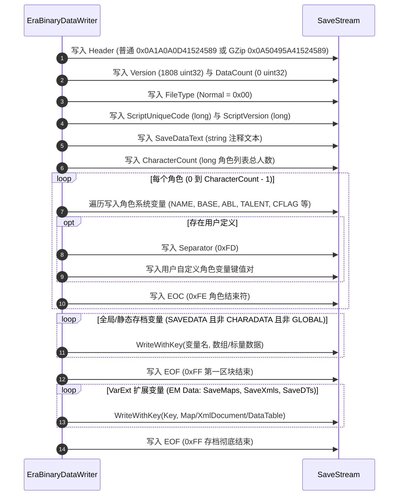

# Emuera / EELib 上游规范全量规格目录 (Upstream Specification Catalog)

> 本文档由 `spec-indexer` 基于 `CloudEmuera.EmueraRuntime` (Emuera.NET 1824+v24+EMv18+EEv55 最新上游源码) 及 `Emuera-Basic-Agent-guide` 提取整理而成。
> 旨在为 Wave 2 及后续 EELib 编译器、虚拟机 (VM)、变量存储与序列化模块开发者提供**高精确定量、免查源码、开箱即用**的技术参考手册。

## 目录概览 (Summary)

| 规范章节 | 覆盖项目数 | 核心源码位置 |
|---|---|---|
| **1. 全量内置命令 (Built-in Instructions)** | **304 项** (+1 NULL, 含 VARI/VARS) | `Runtime/Script/Statements/BuiltInFunctionCode.cs`, `FunctionIdentifier.cs` |
| **2. 全量内置式中函数 (Expression Methods)** | **270 项** (266字面量 + 4扩展) | `Runtime/Script/Statements/Function/Creator.cs`, `Creator.Method.cs` |
| **3. 全量内置变量 (Built-in Variables)** | **171 活跃项** (161标准 + 10动态维度) | `Runtime/Script/Statements/Variable/VariableCode.cs`, `VariableData.cs`, `ConstantData.cs` |
| **4. 配置项、CSV规范与存档线格式** | **113 配置项** + 二进制线协议全貌 | `Runtime/Config/`, `Runtime/Utils/EraBinaryData*.cs`, `differences.md` |

---

## 1. 全量内置命令 (~301项，实际 304 项注册指令)

### 1.1 标志位定义 (FunctionIdentifier Flags)

| Flag 常量 | 十六进制值 | 说明 |
|---|---|---|
| `FLOW_CONTROL` | `0x00001` | 控制流程转移指令 (如 JUMP, CALL, GOTO) |
| `EXTENDED` | `0x00002` | Emuera 独有扩展指令 (非 eramaker 原始指令) |
| `METHOD_SAFE` | `0x00004` | 可在 `#FUNCTION` 中安全调用的指令 (禁止产生交互或跳转) |
| `DEBUG_FUNC` | `0x00008` | 仅在调试模式 (-Debug) 下才执行的指令 |
| `PARTIAL` | `0x00010` | 多行控制结构的一部分 (如 ELSE, CASE)，不能紧跟在 SIF 之后 |
| `FORCE_SETARG` | `0x00020` | 脚本加载阶段必须预先强制解析参数的指令 (如 IF, SELECTCASE) |
| `IS_JUMP` | `0x00040` | 跳转类指令 (JUMP, JUMPFORM) |
| `IS_TRY` | `0x00080` | TRY 类捕获指令 (TRYCALL, TRYJUMP 等) |
| `PRINT_NEWLINE` | `0x00100` | PRINT 指令输出后执行换行 (L 后缀) |
| `PRINT_WAITINPUT` | `0x00200` | PRINT 指令输出后等待输入 (W 后缀) |
| `PRINT_SINGLE` | `0x00400` | PRINTSINGLE 族单次按钮输出 |
| `ISPRINTDFUNC` | `0x00800` | PRINTD 族默认颜色输出 |
| `ISPRINTKFUNC` | `0x01000` | PRINTK 族保持当前颜色输出 |
| `IS_PRINT` | `0x02000` | 受 SkipPrint (跳过打印) 控制影响的输出及 WAIT 族指令 |
| `IS_INPUT` | `0x04000` | 输入指令，用户定义跳过模式下触发警告 |
| `IS_TRYC` | `0x08000` | TRYC 系列条件捕获指令 (TRYCCALL, TRYCGOTO 等) |
| `IS_PRINTDATA` | `0x10000` | PRINTDATA 数据块打印专用判定标志 |

### 1.2 动态 JSON 门控指令 (JSON-Gated Instructions)

> [!IMPORTANT]
> `VARI` 与 `VARS` (局部作用域整数/字符串变量声明) 属于动态条件注入指令：
> - 依赖配置：`JSONConfig.Data.UseScopedVariableInstruction` (在 `setting.json` 中配置)。
> - 机制：在 `FunctionIdentifier.ReloadJsonConfiguredInstructions()` 中判断。若开启则调用 `addFunction(FunctionCode.VARI, new VARI_Instruction())` 与 `VARS`；若未开启则从 `funcDic` 中显式移除，防止普通脚本解析冲突。

### 1.3 内置命令全量清单 (共 304 项)

| 命令代码 (FunctionCode) | 类别 (Category) | 参数解析器 / 执行指令类 | 标志位 (Flags) | 说明与语法特征 |
|---|---|---|---|---|
| **SET** | Assignment | `SET_Instruction` | `0` | 数值或字符串赋值语句 |
| **ADDCOPYCHARA** | Extended / Engine Extensions (EE_OUTPUTLOG) | `new ADDCOPYCHARA_Instruction()` | `0` | - |
| **ALIGNMENT** | Extended / Engine Extensions (EE_OUTPUTLOG) | `argb[FunctionArgType.STR]` | `METHOD_SAFE`, `EXTENDED` | - |
| **ARRAYCOPY** | Extended / Engine Extensions (EE_OUTPUTLOG) | `argb[FunctionArgType.SP_COPY_ARRAY]` | `METHOD_SAFE`, `EXTENDED` | - |
| **ARRAYREMOVE** | Extended / Engine Extensions (EE_OUTPUTLOG) | `argb[FunctionArgType.SP_CONTROL_ARRAY]` | `METHOD_SAFE`, `EXTENDED` | - |
| **ARRAYSHIFT** | Extended / Engine Extensions (EE_OUTPUTLOG) | `argb[FunctionArgType.SP_SHIFT_ARRAY]` | `METHOD_SAFE`, `EXTENDED` | - |
| **ARRAYSORT** | Extended / Engine Extensions (EE_OUTPUTLOG) | `argb[FunctionArgType.SP_SORTARRAY]` | `METHOD_SAFE`, `EXTENDED` | - |
| **BEGIN** | Extended / Engine Extensions (EE_OUTPUTLOG) | `new BEGIN_Instruction()` | `0` | システム関数の実行。実行するとCALLの呼び出し元などを忘れてしまう。 |
| **BREAK** | Extended / Engine Extensions (EE_OUTPUTLOG) | `new BREAK_Instruction()` | `0` | RENDの次の行まで |
| **CALLTRAIN** | Extended / Engine Extensions (EE_OUTPUTLOG) | `argb[FunctionArgType.INT_EXPRESSION]` | `EXTENDED`, `FLOW_CONTROL` | - |
| **CASE** | Extended / Engine Extensions (EE_OUTPUTLOG) | `new ELSEIF_Instruction(FunctionArgType.CASE)` | `EXTENDED` | - |
| **CASEELSE** | Extended / Engine Extensions (EE_OUTPUTLOG) | `new ELSEIF_Instruction(FunctionArgType.VOID)` | `EXTENDED` | - |
| **CLEARBGIMAGE** | Extended / Engine Extensions (EE_OUTPUTLOG) | `new CLEARBGIMAGE_Instruction()` | `0` | - |
| **CLEARBIT** | Extended / Engine Extensions (EE_OUTPUTLOG) | `new SETBIT_Instruction(0)` | `0` | - |
| **CLEARTEXTBOX** | Extended / Engine Extensions (EE_OUTPUTLOG) | `argb[FunctionArgType.VOID]` | `METHOD_SAFE`, `EXTENDED` | - |
| **CONTINUE** | Extended / Engine Extensions (EE_OUTPUTLOG) | `new CONTINUE_Instruction()` | `0` | REPEATに戻る |
| **COPYCHARA** | Extended / Engine Extensions (EE_OUTPUTLOG) | `new COPYCHARA_Instruction()` | `0` | - |
| **CUSTOMDRAWLINE** | Extended / Engine Extensions (EE_OUTPUTLOG) | `new CUSTOMDRAWLINE_Instruction()` | `0` | - |
| **CVARSET** | Extended / Engine Extensions (EE_OUTPUTLOG) | `new CVARSET_Instruction()` | `0` | - |
| **DATA** | Extended / Engine Extensions (EE_OUTPUTLOG) | `argb[FunctionArgType.STR_NULLABLE]` | `METHOD_SAFE`, `EXTENDED`, `PARTIAL`, `PARTIAL` | - |
| **DATAFORM** | Extended / Engine Extensions (EE_OUTPUTLOG) | `argb[FunctionArgType.FORM_STR_NULLABLE]` | `METHOD_SAFE`, `EXTENDED`, `PARTIAL` | - |
| **DATALIST** | Extended / Engine Extensions (EE_OUTPUTLOG) | `argb[FunctionArgType.VOID]` | `METHOD_SAFE`, `EXTENDED`, `PARTIAL` | - |
| **DELALLCHARA** | Extended / Engine Extensions (EE_OUTPUTLOG) | `argb[FunctionArgType.VOID]` | `METHOD_SAFE`, `EXTENDED` | - |
| **DELDATA** | Extended / Engine Extensions (EE_OUTPUTLOG) | `new DELDATA_Instruction()` | `0` | - |
| **DO** | Extended / Engine Extensions (EE_OUTPUTLOG) | `new ENDIF_Instruction()` | `METHOD_SAFE`, `EXTENDED` | - |
| **DOTRAIN** | Extended / Engine Extensions (EE_OUTPUTLOG) | `argb[FunctionArgType.INT_EXPRESSION]` | `EXTENDED`, `FLOW_CONTROL` | - |
| **DRAWLINEFORM** | Extended / Engine Extensions (EE_OUTPUTLOG) | `argb[FunctionArgType.FORM_STR]` | `METHOD_SAFE`, `EXTENDED` | - |
| **DUMPRAND** | Extended / Engine Extensions (EE_OUTPUTLOG) | `new DUMPRAND_Instruction()` | `0` | - |
| **ELSE** | Extended / Engine Extensions (EE_OUTPUTLOG) | `new ELSEIF_Instruction(FunctionArgType.VOID)` | `0` | - |
| **ELSEIF** | Extended / Engine Extensions (EE_OUTPUTLOG) | `new ELSEIF_Instruction(FunctionArgType.INT_EXPRESSION)` | `0` | - |
| **ENDDATA** | Extended / Engine Extensions (EE_OUTPUTLOG) | `new DO_NOTHING_Instruction()` | `0` | - |
| **ENDIF** | Extended / Engine Extensions (EE_OUTPUTLOG) | `new ENDIF_Instruction()` | `METHOD_SAFE` | - |
| **ENDLIST** | Extended / Engine Extensions (EE_OUTPUTLOG) | `argb[FunctionArgType.VOID]` | `METHOD_SAFE`, `EXTENDED`, `PARTIAL` | - |
| **ENDNOSKIP** | Extended / Engine Extensions (EE_OUTPUTLOG) | `argb[FunctionArgType.VOID]` | `METHOD_SAFE`, `EXTENDED`, `PARTIAL` | - |
| **ENDSELECT** | Extended / Engine Extensions (EE_OUTPUTLOG) | `new ENDIF_Instruction()` | `METHOD_SAFE`, `EXTENDED` | - |
| **FONTBOLD** | Extended / Engine Extensions (EE_OUTPUTLOG) | `new FONTBOLD_Instruction()` | `0` | - |
| **FONTITALIC** | Extended / Engine Extensions (EE_OUTPUTLOG) | `new FONTITALIC_Instruction()` | `0` | - |
| **FONTREGULAR** | Extended / Engine Extensions (EE_OUTPUTLOG) | `new FONTREGULAR_Instruction()` | `0` | - |
| **FONTSTYLE** | Extended / Engine Extensions (EE_OUTPUTLOG) | `argb[FunctionArgType.INT_EXPRESSION_NULLABLE]` | `METHOD_SAFE`, `EXTENDED` | - |
| **FOR** | Extended / Engine Extensions (EE_OUTPUTLOG) | `new REPEAT_Instruction(true)` | `EXTENDED` | - |
| **FORCEKANA** | Extended / Engine Extensions (EE_OUTPUTLOG) | `argb[FunctionArgType.INT_EXPRESSION]` | `METHOD_SAFE`, `EXTENDED` | - |
| **IF** | Extended / Engine Extensions (EE_OUTPUTLOG) | `new IF_Instruction()` | `0` | - |
| **INITRAND** | Extended / Engine Extensions (EE_OUTPUTLOG) | `new INITRAND_Instruction()` | `0` | - |
| **INVERTBIT** | Extended / Engine Extensions (EE_OUTPUTLOG) | `new SETBIT_Instruction(-1)` | `0` | - |
| **LOADDATA** | Extended / Engine Extensions (EE_OUTPUTLOG) | `argb[FunctionArgType.INT_EXPRESSION]` | `EXTENDED`, `FLOW_CONTROL` | - |
| **LOADGAME** | Extended / Engine Extensions (EE_OUTPUTLOG) | `new SAVELOADGAME_Instruction(false)` | `0` | - |
| **LOADGLOBAL** | Extended / Engine Extensions (EE_OUTPUTLOG) | `new LOADGLOBAL_Instruction()` | `0` | - |
| **LOOP** | Extended / Engine Extensions (EE_OUTPUTLOG) | `new LOOP_Instruction()` | `0` | - |
| **NEXT** | Extended / Engine Extensions (EE_OUTPUTLOG) | `new REND_Instruction()` | `EXTENDED` | - |
| **NOSKIP** | Extended / Engine Extensions (EE_OUTPUTLOG) | `argb[FunctionArgType.VOID]` | `METHOD_SAFE`, `EXTENDED`, `PARTIAL` | - |
| **PICKUPCHARA** | Extended / Engine Extensions (EE_OUTPUTLOG) | `argb[FunctionArgType.INT_ANY]` | `METHOD_SAFE`, `EXTENDED` | - |
| **RANDOMIZE** | Extended / Engine Extensions (EE_OUTPUTLOG) | `new RANDOMIZE_Instruction()` | `0` | - |
| **REDRAW** | Extended / Engine Extensions (EE_OUTPUTLOG) | `argb[FunctionArgType.INT_EXPRESSION]` | `METHOD_SAFE`, `EXTENDED` | - |
| **REMOVEBGIMAGE** | Extended / Engine Extensions (EE_OUTPUTLOG) | `new REMOVEBGIMAGE_Instruction()` | `0` | - |
| **REND** | Extended / Engine Extensions (EE_OUTPUTLOG) | `new REND_Instruction()` | `0` | - |
| **REPEAT** | Extended / Engine Extensions (EE_OUTPUTLOG) | `new REPEAT_Instruction(false)` | `0` | RENDまで繰り返し。繰り返した回数がCOUNTへ。ネスト不可。 |
| **RESET_STAIN** | Extended / Engine Extensions (EE_OUTPUTLOG) | `argb[FunctionArgType.INT_EXPRESSION]` | `METHOD_SAFE`, `EXTENDED` | - |
| **RESETBGCOLOR** | Extended / Engine Extensions (EE_OUTPUTLOG) | `new RESETBGCOLOR_Instruction()` | `0` | - |
| **RESETCOLOR** | Extended / Engine Extensions (EE_OUTPUTLOG) | `new RESETCOLOR_Instruction()` | `0` | - |
| **RESETDATA** | Extended / Engine Extensions (EE_OUTPUTLOG) | `new RESETDATA_Instruction()` | `0` | - |
| **RESETGLOBAL** | Extended / Engine Extensions (EE_OUTPUTLOG) | `new RESETGLOBAL_Instruction()` | `0` | - |
| **RETURN** | Extended / Engine Extensions (EE_OUTPUTLOG) | `new RETURN_Instruction()` | `0` | 関数の終了。RESULTに整数を格納可能。省略した場合、０。(次の@～～がRETURNと見なされる。) |
| **RETURNF** | Extended / Engine Extensions (EE_OUTPUTLOG) | `new RETURNF_Instruction()` | `0` | - |
| **RETURNFORM** | Extended / Engine Extensions (EE_OUTPUTLOG) | `new RETURNFORM_Instruction()` | `0` | 関数の終了。RESULTに整数を格納可能。省略した場合、０。(次の@～～がRETURNと見なされる。) |
| **SAVEDATA** | Extended / Engine Extensions (EE_OUTPUTLOG) | `argb[FunctionArgType.SP_SAVEDATA]` | `METHOD_SAFE`, `EXTENDED` | - |
| **SAVEGAME** | Extended / Engine Extensions (EE_OUTPUTLOG) | `new SAVELOADGAME_Instruction(true)` | `0` | セーブ画面を呼ぶ。ショップのみ。 |
| **SAVEGLOBAL** | Extended / Engine Extensions (EE_OUTPUTLOG) | `new SAVEGLOBAL_Instruction()` | `0` | - |
| **SELECTCASE** | Extended / Engine Extensions (EE_OUTPUTLOG) | `new SELECTCASE_Instruction()` | `0` | - |
| **SETBGCOLOR** | Extended / Engine Extensions (EE_OUTPUTLOG) | `argb[FunctionArgType.SP_COLOR]` | `METHOD_SAFE`, `EXTENDED` | - |
| **SETBGCOLORBYNAME** | Extended / Engine Extensions (EE_OUTPUTLOG) | `argb[FunctionArgType.STR]` | `METHOD_SAFE`, `EXTENDED` | - |
| **SETBGIMAGE** | Extended / Engine Extensions (EE_OUTPUTLOG) | `new SETBGIMAGE_Instruction()` | `0` | - |
| **SETBIT** | Extended / Engine Extensions (EE_OUTPUTLOG) | `new SETBIT_Instruction(1)` | `0` | - |
| **SETCOLOR** | Extended / Engine Extensions (EE_OUTPUTLOG) | `argb[FunctionArgType.SP_COLOR]` | `METHOD_SAFE`, `EXTENDED` | - |
| **SETCOLORBYNAME** | Extended / Engine Extensions (EE_OUTPUTLOG) | `argb[FunctionArgType.STR]` | `METHOD_SAFE`, `EXTENDED` | - |
| **SETFONT** | Extended / Engine Extensions (EE_OUTPUTLOG) | `argb[FunctionArgType.STR_EXPRESSION_NULLABLE]` | `METHOD_SAFE`, `EXTENDED` | - |
| **SIF** | Extended / Engine Extensions (EE_OUTPUTLOG) | `new SIF_Instruction()` | `0` | 一行のみIF |
| **SKIPDISP** | Extended / Engine Extensions (EE_OUTPUTLOG) | `argb[FunctionArgType.INT_EXPRESSION]` | `METHOD_SAFE`, `EXTENDED` | - |
| **SORTCHARA** | Extended / Engine Extensions (EE_OUTPUTLOG) | `new SORTCHARA_Instruction()` | `0` | - |
| **SPLIT** | Extended / Engine Extensions (EE_OUTPUTLOG) | `argb[FunctionArgType.SP_SPLIT]` | `METHOD_SAFE`, `EXTENDED` | - |
| **STOPCALLTRAIN** | Extended / Engine Extensions (EE_OUTPUTLOG) | `argb[FunctionArgType.VOID]` | `EXTENDED`, `FLOW_CONTROL` | - |
| **STRDATA** | Extended / Engine Extensions (EE_OUTPUTLOG) | `argb[FunctionArgType.VAR_STR]` | `METHOD_SAFE`, `EXTENDED`, `PARTIAL` | - |
| **STRLEN** | Extended / Engine Extensions (EE_OUTPUTLOG) | `new STRLEN_Instruction(false, false)` | `0` | - |
| **STRLENFORM** | Extended / Engine Extensions (EE_OUTPUTLOG) | `new STRLEN_Instruction(true, false)` | `0` | - |
| **STRLENFORMU** | Extended / Engine Extensions (EE_OUTPUTLOG) | `new STRLEN_Instruction(true, true)` | `0` | - |
| **STRLENU** | Extended / Engine Extensions (EE_OUTPUTLOG) | `new STRLEN_Instruction(false, true)` | `0` | - |
| **SWAP** | Extended / Engine Extensions (EE_OUTPUTLOG) | `argb[FunctionArgType.SP_SWAPVAR]` | `METHOD_SAFE`, `EXTENDED` | - |
| **SWAPCHARA** | Extended / Engine Extensions (EE_OUTPUTLOG) | `new SWAPCHARA_Instruction()` | `0` | - |
| **VARSET** | Extended / Engine Extensions (EE_OUTPUTLOG) | `new VARSET_Instruction()` | `0` | - |
| **WEND** | Extended / Engine Extensions (EE_OUTPUTLOG) | `new WEND_Instruction()` | `0` | - |
| **WHILE** | Extended / Engine Extensions (EE_OUTPUTLOG) | `new WHILE_Instruction()` | `0` | - |
| **ASSERT** | Extended / Engine Extensions (EE_SKIPLOG) | `argb[FunctionArgType.INT_EXPRESSION]` | `METHOD_SAFE`, `EXTENDED`, `DEBUG_FUNC` | - |
| **AWAIT** | Extended / Engine Extensions (EE_SKIPLOG) | `new AWAIT_Instruction()` | `0` | 入力不可 DoEvents |
| **CALL** | Extended / Engine Extensions (EE_SKIPLOG) | `new CALL_Instruction(false, false, false, false)` | `0` | 関数に移動。移動元を記憶し、RETURNで帰る。 |
| **CALLEVENT** | Extended / Engine Extensions (EE_SKIPLOG) | `new CALLEVENT_Instruction()` | `0` | - |
| **CALLF** | Extended / Engine Extensions (EE_SKIPLOG) | `new CALLF_Instruction(false)` | `0` | - |
| **CALLFORM** | Extended / Engine Extensions (EE_SKIPLOG) | `new CALL_Instruction(true, false, false, false)` | `EXTENDED` | - |
| **CALLFORMF** | Extended / Engine Extensions (EE_SKIPLOG) | `new CALLF_Instruction(true)` | `0` | - |
| **CALLSHARP** | Extended / Engine Extensions (EE_SKIPLOG) | `new CALLSHARP_Instruction()` | `0` | - |
| **CATCH** | Extended / Engine Extensions (EE_SKIPLOG) | `new CATCH_Instruction()` | `0` | - |
| **DEBUGCLEAR** | Extended / Engine Extensions (EE_SKIPLOG) | `new DEBUGCLEAR_Instruction()` | `0` | - |
| **DEBUGPRINT** | Extended / Engine Extensions (EE_SKIPLOG) | `new DEBUGPRINT_Instruction(false, false)` | `0` | - |
| **DEBUGPRINTFORM** | Extended / Engine Extensions (EE_SKIPLOG) | `new DEBUGPRINT_Instruction(true, false)` | `0` | - |
| **DEBUGPRINTFORML** | Extended / Engine Extensions (EE_SKIPLOG) | `new DEBUGPRINT_Instruction(true, true)` | `0` | - |
| **DEBUGPRINTL** | Extended / Engine Extensions (EE_SKIPLOG) | `new DEBUGPRINT_Instruction(false, true)` | `0` | - |
| **ENDCATCH** | Extended / Engine Extensions (EE_SKIPLOG) | `new ENDIF_Instruction()` | `METHOD_SAFE`, `EXTENDED` | - |
| **ENDFUNC** | Extended / Engine Extensions (EE_SKIPLOG) | `new ENDIF_Instruction()` | `EXTENDED` | - |
| **FUNC** | Extended / Engine Extensions (EE_SKIPLOG) | `argb[FunctionArgType.SP_CALLFORM]` | `EXTENDED`, `FLOW_CONTROL`, `PARTIAL`, `FORCE_SETARG` | - |
| **GOTO** | Extended / Engine Extensions (EE_SKIPLOG) | `new GOTO_Instruction(false, false, false)` | `0` | $ラベルへジャンプ |
| **GOTOFORM** | Extended / Engine Extensions (EE_SKIPLOG) | `new GOTO_Instruction(true, false, false)` | `EXTENDED` | - |
| **HTML_PRINT** | Extended / Engine Extensions (EE_SKIPLOG) | `new HTML_PRINT_Instruction()` | `0` | - |
| **HTML_TAGSPLIT** | Extended / Engine Extensions (EE_SKIPLOG) | `new HTML_TAGSPLIT_Instruction()` | `0` | - |
| **INPUTMOUSEKEY** | Extended / Engine Extensions (EE_SKIPLOG) | `new INPUTMOUSEKEY_Instruction()` | `0` | - |
| **JUMP** | Extended / Engine Extensions (EE_SKIPLOG) | `new CALL_Instruction(false, true, false, false)` | `0` | 関数に移動 |
| **JUMPFORM** | Extended / Engine Extensions (EE_SKIPLOG) | `new CALL_Instruction(true, true, false, false)` | `EXTENDED` | - |
| **LOADCHARA** | Extended / Engine Extensions (EE_SKIPLOG) | `new LOADCHARA_Instruction()` | `0` | - |
| **LOADVAR** | Extended / Engine Extensions (EE_SKIPLOG) | `new LOADVAR_Instruction()` | `0` | - |
| **PRINT_IMG** | Extended / Engine Extensions (EE_SKIPLOG) | `new PRINT_IMG_Instruction()` | `0` | - |
| **PRINT_RECT** | Extended / Engine Extensions (EE_SKIPLOG) | `new PRINT_RECT_Instruction()` | `0` | - |
| **PRINT_SPACE** | Extended / Engine Extensions (EE_SKIPLOG) | `new PRINT_SPACE_Instruction()` | `0` | - |
| **REF** | Extended / Engine Extensions (EE_SKIPLOG) | `new REF_Instruction(false)` | `0` | - |
| **REFBYNAME** | Extended / Engine Extensions (EE_SKIPLOG) | `new REF_Instruction(true)` | `0` | - |
| **RESTART** | Extended / Engine Extensions (EE_SKIPLOG) | `new RESTART_Instruction()` | `0` | 関数の再開。関数の最初に戻る。 |
| **SAVECHARA** | Extended / Engine Extensions (EE_SKIPLOG) | `new SAVECHARA_Instruction()` | `0` | - |
| **SAVEVAR** | Extended / Engine Extensions (EE_SKIPLOG) | `new SAVEVAR_Instruction()` | `0` | - |
| **SKIPLOG** | Extended / Engine Extensions (EE_SKIPLOG) | `argb[FunctionArgType.INT_EXPRESSION]` | `METHOD_SAFE`, `EXTENDED` | - |
| **THROW** | Extended / Engine Extensions (EE_SKIPLOG) | `argb[FunctionArgType.FORM_STR_NULLABLE]` | `METHOD_SAFE`, `EXTENDED` | - |
| **TOOLTIP_SETCOLOR** | Extended / Engine Extensions (EE_SKIPLOG) | `new TOOLTIP_SETCOLOR_Instruction()` | `0` | - |
| **TOOLTIP_SETDELAY** | Extended / Engine Extensions (EE_SKIPLOG) | `new TOOLTIP_SETDELAY_Instruction()` | `0` | - |
| **TOOLTIP_SETDURATION** | Extended / Engine Extensions (EE_SKIPLOG) | `new TOOLTIP_SETDURATION_Instruction()` | `0` | - |
| **TRYCALL** | Extended / Engine Extensions (EE_SKIPLOG) | `new CALL_Instruction(false, false, true, false)` | `EXTENDED` | - |
| **TRYCALLFORM** | Extended / Engine Extensions (EE_SKIPLOG) | `new CALL_Instruction(true, false, true, false)` | `EXTENDED` | - |
| **TRYCALLLIST** | Extended / Engine Extensions (EE_SKIPLOG) | `argb[FunctionArgType.VOID]` | `EXTENDED`, `FLOW_CONTROL`, `PARTIAL`, `IS_TRY` | - |
| **TRYCCALL** | Extended / Engine Extensions (EE_SKIPLOG) | `new CALL_Instruction(false, false, true, true)` | `EXTENDED` | - |
| **TRYCCALLFORM** | Extended / Engine Extensions (EE_SKIPLOG) | `new CALL_Instruction(true, false, true, true)` | `EXTENDED` | - |
| **TRYCGOTO** | Extended / Engine Extensions (EE_SKIPLOG) | `new GOTO_Instruction(false, true, true)` | `EXTENDED` | - |
| **TRYCGOTOFORM** | Extended / Engine Extensions (EE_SKIPLOG) | `new GOTO_Instruction(true, true, true)` | `EXTENDED` | - |
| **TRYCJUMP** | Extended / Engine Extensions (EE_SKIPLOG) | `new CALL_Instruction(false, true, true, true)` | `EXTENDED` | - |
| **TRYCJUMPFORM** | Extended / Engine Extensions (EE_SKIPLOG) | `new CALL_Instruction(true, true, true, true)` | `EXTENDED` | - |
| **TRYGOTO** | Extended / Engine Extensions (EE_SKIPLOG) | `new GOTO_Instruction(false, true, false)` | `EXTENDED` | - |
| **TRYGOTOFORM** | Extended / Engine Extensions (EE_SKIPLOG) | `new GOTO_Instruction(true, true, false)` | `EXTENDED` | - |
| **TRYGOTOLIST** | Extended / Engine Extensions (EE_SKIPLOG) | `argb[FunctionArgType.VOID]` | `EXTENDED`, `FLOW_CONTROL`, `PARTIAL`, `IS_TRY` | - |
| **TRYJUMP** | Extended / Engine Extensions (EE_SKIPLOG) | `new CALL_Instruction(false, true, true, false)` | `EXTENDED` | - |
| **TRYJUMPFORM** | Extended / Engine Extensions (EE_SKIPLOG) | `new CALL_Instruction(true, true, true, false)` | `EXTENDED` | - |
| **TRYJUMPLIST** | Extended / Engine Extensions (EE_SKIPLOG) | `argb[FunctionArgType.VOID]` | `EXTENDED`, `FLOW_CONTROL`, `PARTIAL`, `IS_JUMP`, `IS_TRY` | - |
| **BINPUT** | Extended / Engine Extensions (EE) | `new BINPUT_Instruction()` | `0` | - |
| **BINPUTS** | Extended / Engine Extensions (EE) | `new BINPUTS_Instruction()` | `0` | - |
| **BREAKBUTTON** | Extended / Engine Extensions (EE) | `new BREAKBUTTON_Instruction()` | `0` | - |
| **FORCE_BEGIN** | Extended / Engine Extensions (EE) | `new FORCE_BEGIN_Instruction()` | `0` | 強制BEGIN |
| **FORCE_QUIT** | Extended / Engine Extensions (EE) | `argb[FunctionArgType.VOID]` | `0` | - |
| **FORCE_QUIT_AND_RESTART** | Extended / Engine Extensions (EE) | `argb[FunctionArgType.VOID]` | `0` | - |
| **INPUTANY** | Extended / Engine Extensions (EE) | `new INPUTANY_Instruction()` | `0` | - |
| **ONEBINPUT** | Extended / Engine Extensions (EE) | `new ONEBINPUT_Instruction()` | `0` | - |
| **ONEBINPUTS** | Extended / Engine Extensions (EE) | `new ONEBINPUTS_Instruction()` | `0` | - |
| **PLAYBGM** | Extended / Engine Extensions (EE) | `new PLAYBGM_Instruction()` | `0` | - |
| **PLAYSOUND** | Extended / Engine Extensions (EE) | `new PLAYSOUND_Instruction()` | `0` | - |
| **QUIT_AND_RESTART** | Extended / Engine Extensions (EE) | `argb[FunctionArgType.VOID]` | `0` | ゲームを終了 |
| **SETBGMVOLUME** | Extended / Engine Extensions (EE) | `new SETBGMVOLUME_Instruction()` | `0` | - |
| **SETSOUNDVOLUME** | Extended / Engine Extensions (EE) | `new SETSOUNDVOLUME_Instruction()` | `0` | - |
| **STOPBGM** | Extended / Engine Extensions (EE) | `new STOPBGM_Instruction()` | `0` | - |
| **STOPSOUND** | Extended / Engine Extensions (EE) | `new STOPSOUND_Instruction()` | `0` | - |
| **TOOLTIP_CUSTOM** | Extended / Engine Extensions (EE) | `new TOOLTIP_CUSTOM_Instruction()` | `0` | - |
| **TOOLTIP_FORMAT** | Extended / Engine Extensions (EE) | `new TOOLTIP_FORMAT_Instruction()` | `0` | - |
| **TOOLTIP_IMG** | Extended / Engine Extensions (EE) | `new TOOLTIP_IMG_Instruction()` | `0` | - |
| **TOOLTIP_SETFONT** | Extended / Engine Extensions (EE) | `new TOOLTIP_SETFONT_Instruction()` | `0` | - |
| **TOOLTIP_SETFONTSIZE** | Extended / Engine Extensions (EE) | `new TOOLTIP_SETFONTSIZE_Instruction()` | `0` | - |
| **TRYCALLF** | Extended / Engine Extensions (EE) | `new TRYCALLF_Instruction(false)` | `0` | - |
| **TRYCALLFORMF** | Extended / Engine Extensions (EE) | `new TRYCALLF_Instruction(true)` | `0` | - |
| **UPDATECHECK** | Extended / Engine Extensions (EE) | `new UPDATECHECK_Instruction()` | `0` | - |
| **DT_COLUMN_OPTIONS** | Extended / Engine Extensions (EM) | `new DT_COLUMN_OPTIONS_Instruction()` | `0` | - |
| **HTML_PRINT_ISLAND** | Extended / Engine Extensions (Emuera.NET) | `new HTML_PRINT_ISLAND_Instruction()` | `0` | - |
| **HTML_PRINT_ISLAND_CLEAR** | Extended / Engine Extensions (Emuera.NET) | `new HTML_PRINT_ISLAND_CLEAR_Instruction()` | `0` | - |
| **VARI** | Extended / Engine Extensions (Emuera.NET) | `new VARI_Instruction()` | `0` | - |
| **VARS** | Extended / Engine Extensions (Emuera.NET) | `new VARS_Instruction()` | `0` | - |
| **ENCODETOUNI** | Instruction Form of Expression Functions | `argb[FunctionArgType.FORM_STR_NULLABLE]` | `METHOD_SAFE`, `EXTENDED` | 式中関数版を追加。処理が全然違う |
| **GETTIME** | Instruction Form of Expression Functions | `argb[FunctionArgType.VOID]` | `METHOD_SAFE`, `EXTENDED` | 2つに代入する必要があるのでMETHOD化できない |
| **POWER** | Instruction Form of Expression Functions | `argb[FunctionArgType.SP_POWER]` | `METHOD_SAFE`, `EXTENDED` | 引数が違うのでMETHOD化できない。 |
| **PRINTCPERLINE** | Instruction Form of Expression Functions | `argb[FunctionArgType.SP_GETINT]` | `METHOD_SAFE`, `EXTENDED` | よく考えたら引数の仕様違うや |
| **SAVENOS** | Instruction Form of Expression Functions | `argb[FunctionArgType.SP_GETINT]` | `METHOD_SAFE`, `EXTENDED` | 引数の仕様が違うので(ry |
| **VARSIZE** | Instruction Form of Expression Functions | `argb[FunctionArgType.SP_VAR]` | `METHOD_SAFE`, `EXTENDED` | 動作が違うのでMETHOD化できない |
| **ADDCHARA** | PRINT or INPUT | `new ADDCHARA_Instruction(false, false)` | `0` | (キャラ番号)のキャラクタを追加 |
| **ADDDEFCHARA** | PRINT or INPUT | `argb[FunctionArgType.VOID]` | `METHOD_SAFE`, `EXTENDED` | - |
| **ADDSPCHARA** | PRINT or INPUT | `new ADDCHARA_Instruction(true, false)` | `0` | (キャラ番号)のSPキャラクタを追加（フラグ0を1にして作成） |
| **ADDVOIDCHARA** | PRINT or INPUT | `new ADDVOIDCHARA_Instruction()` | `0` | 変数に何の設定のないキャラを作成 |
| **BAR** | PRINT or INPUT | `new BAR_Instruction(false)` | `0` | [*****....]のようなグラフを書く。BAR (変数) , (最大値), (長さ) |
| **BARL** | PRINT or INPUT | `new BAR_Instruction(true)` | `0` | 改行付き。 |
| **CLEARLINE** | PRINT or INPUT | `new CLEARLINE_Instruction()` | `0` | - |
| **CUPCHECK** | PRINT or INPUT | `argb[FunctionArgType.INT_EXPRESSION]` | `METHOD_SAFE`, `EXTENDED` | - |
| **DELCHARA** | PRINT or INPUT | `new ADDCHARA_Instruction(false, true)` | `0` | (キャラ登録番号)のキャラクタを削除。 |
| **DRAWLINE** | PRINT or INPUT | `argb[FunctionArgType.VOID]` | `METHOD_SAFE` | 画面の左端から右端まで----と線を引く。 |
| **FORCEWAIT** | PRINT or INPUT | `new WAIT_Instruction(true)` | `0` | スキップで省略できないWAIT、強制TWAITと違い、スキップを打ち切る |
| **INPUT** | PRINT or INPUT | `new INPUT_Instruction()` | `0` | 整数入力。入力はRESULTへ。 |
| **INPUTS** | PRINT or INPUT | `new INPUTS_Instruction()` | `0` | 文字列入力。入力はRESULTSへ。 |
| **ONEINPUT** | PRINT or INPUT | `new ONEINPUT_Instruction()` | `0` | - |
| **ONEINPUTS** | PRINT or INPUT | `new ONEINPUTS_Instruction()` | `0` | - |
| **PRINT** | PRINT or INPUT | `PRINT_Instruction` | `IS_PRINT` | 文字を表示する |
| **PRINT_ABL** | PRINT or INPUT | `argb[FunctionArgType.INT_EXPRESSION]` | `METHOD_SAFE` | 能力。引数は登録番号 |
| **PRINT_EXP** | PRINT or INPUT | `argb[FunctionArgType.INT_EXPRESSION]` | `METHOD_SAFE` | 経験 |
| **PRINT_ITEM** | PRINT or INPUT | `argb[FunctionArgType.VOID]` | `METHOD_SAFE` | 所持アイテム |
| **PRINT_MARK** | PRINT or INPUT | `argb[FunctionArgType.INT_EXPRESSION]` | `METHOD_SAFE` | 刻印 |
| **PRINT_PALAM** | PRINT or INPUT | `argb[FunctionArgType.INT_EXPRESSION]` | `METHOD_SAFE` | パラメータ |
| **PRINT_SHOPITEM** | PRINT or INPUT | `argb[FunctionArgType.VOID]` | `METHOD_SAFE` | ショップで売っているアイテム |
| **PRINT_TALENT** | PRINT or INPUT | `argb[FunctionArgType.INT_EXPRESSION]` | `METHOD_SAFE` | 素質 |
| **PRINTBUTTON** | PRINT or INPUT | `argb[FunctionArgType.SP_BUTTON]` | `METHOD_SAFE`, `EXTENDED` | - |
| **PRINTBUTTONC** | PRINT or INPUT | `argb[FunctionArgType.SP_BUTTON]` | `METHOD_SAFE`, `EXTENDED` | - |
| **PRINTBUTTONLC** | PRINT or INPUT | `argb[FunctionArgType.SP_BUTTON]` | `METHOD_SAFE`, `EXTENDED` | - |
| **PRINTC** | PRINT or INPUT | `PRINT_Instruction` | `IS_PRINT` | ?? |
| **PRINTCD** | PRINT or INPUT | `PRINT_Instruction` | `IS_PRINT` | ?? |
| **PRINTCK** | PRINT or INPUT | `PRINT_Instruction` | `IS_PRINT` | ?? |
| **PRINTD** | PRINT or INPUT | `PRINT_Instruction` | `IS_PRINT` | 文字を表示する |
| **PRINTDL** | PRINT or INPUT | `PRINT_Instruction` | `IS_PRINT` | 改行 |
| **PRINTDW** | PRINT or INPUT | `PRINT_Instruction` | `IS_PRINT` | 入力待ち(実質改行) |
| **PRINTFORM** | PRINT or INPUT | `PRINT_Instruction` | `IS_PRINT` | {数式}、%文字列変数%などの書式が使える。 |
| **PRINTFORMC** | PRINT or INPUT | `PRINT_Instruction` | `IS_PRINT` | - |
| **PRINTFORMCD** | PRINT or INPUT | `PRINT_Instruction` | `IS_PRINT` | - |
| **PRINTFORMCK** | PRINT or INPUT | `PRINT_Instruction` | `IS_PRINT` | - |
| **PRINTFORMD** | PRINT or INPUT | `PRINT_Instruction` | `IS_PRINT` | {数式}、%文字列変数%などの書式が使える。 |
| **PRINTFORMDL** | PRINT or INPUT | `PRINT_Instruction` | `IS_PRINT` | - |
| **PRINTFORMDW** | PRINT or INPUT | `PRINT_Instruction` | `IS_PRINT` | - |
| **PRINTFORMK** | PRINT or INPUT | `PRINT_Instruction` | `IS_PRINT` | {数式}、%文字列変数%などの書式が使える。 |
| **PRINTFORMKL** | PRINT or INPUT | `PRINT_Instruction` | `IS_PRINT` | - |
| **PRINTFORMKW** | PRINT or INPUT | `PRINT_Instruction` | `IS_PRINT` | - |
| **PRINTFORML** | PRINT or INPUT | `PRINT_Instruction` | `IS_PRINT` | - |
| **PRINTFORMLC** | PRINT or INPUT | `PRINT_Instruction` | `IS_PRINT` | - |
| **PRINTFORMLCD** | PRINT or INPUT | `PRINT_Instruction` | `IS_PRINT` | - |
| **PRINTFORMLCK** | PRINT or INPUT | `PRINT_Instruction` | `IS_PRINT` | - |
| **PRINTFORMN** | PRINT or INPUT | `PRINT_Instruction` | `IS_PRINT` | - |
| **PRINTFORMS** | PRINT or INPUT | `PRINT_Instruction` | `IS_PRINT` | 文字列変数の内容を変換して表示。 |
| **PRINTFORMSD** | PRINT or INPUT | `PRINT_Instruction` | `IS_PRINT` | 文字列変数の内容を変換して表示。 |
| **PRINTFORMSDL** | PRINT or INPUT | `PRINT_Instruction` | `IS_PRINT` | - |
| **PRINTFORMSDW** | PRINT or INPUT | `PRINT_Instruction` | `IS_PRINT` | - |
| **PRINTFORMSK** | PRINT or INPUT | `PRINT_Instruction` | `IS_PRINT` | 文字列変数の内容を変換して表示。 |
| **PRINTFORMSKL** | PRINT or INPUT | `PRINT_Instruction` | `IS_PRINT` | - |
| **PRINTFORMSKW** | PRINT or INPUT | `PRINT_Instruction` | `IS_PRINT` | - |
| **PRINTFORMSL** | PRINT or INPUT | `PRINT_Instruction` | `IS_PRINT` | - |
| **PRINTFORMSN** | PRINT or INPUT | `PRINT_Instruction` | `IS_PRINT` | - |
| **PRINTFORMSW** | PRINT or INPUT | `PRINT_Instruction` | `IS_PRINT` | - |
| **PRINTFORMW** | PRINT or INPUT | `PRINT_Instruction` | `IS_PRINT` | - |
| **PRINTK** | PRINT or INPUT | `PRINT_Instruction` | `IS_PRINT` | - |
| **PRINTKL** | PRINT or INPUT | `PRINT_Instruction` | `IS_PRINT` | - |
| **PRINTKW** | PRINT or INPUT | `PRINT_Instruction` | `IS_PRINT` | - |
| **PRINTL** | PRINT or INPUT | `PRINT_Instruction` | `IS_PRINT` | 改行 |
| **PRINTLC** | PRINT or INPUT | `PRINT_Instruction` | `IS_PRINT` | - |
| **PRINTLCD** | PRINT or INPUT | `PRINT_Instruction` | `IS_PRINT` | - |
| **PRINTLCK** | PRINT or INPUT | `PRINT_Instruction` | `IS_PRINT` | - |
| **PRINTN** | PRINT or INPUT | `PRINT_Instruction` | `IS_PRINT` | 改行をしないで入力待ち |
| **PRINTPLAIN** | PRINT or INPUT | `argb[FunctionArgType.STR_NULLABLE]` | `METHOD_SAFE`, `EXTENDED` | - |
| **PRINTPLAINFORM** | PRINT or INPUT | `argb[FunctionArgType.FORM_STR_NULLABLE]` | `METHOD_SAFE`, `EXTENDED` | - |
| **PRINTS** | PRINT or INPUT | `PRINT_Instruction` | `IS_PRINT` | 文字列変数の内容 |
| **PRINTSD** | PRINT or INPUT | `PRINT_Instruction` | `IS_PRINT` | 文字列変数の内容 |
| **PRINTSDL** | PRINT or INPUT | `PRINT_Instruction` | `IS_PRINT` | - |
| **PRINTSDW** | PRINT or INPUT | `PRINT_Instruction` | `IS_PRINT` | - |
| **PRINTSINGLE** | PRINT or INPUT | `PRINT_Instruction` | `IS_PRINT` | - |
| **PRINTSINGLED** | PRINT or INPUT | `PRINT_Instruction` | `IS_PRINT` | - |
| **PRINTSINGLEFORM** | PRINT or INPUT | `PRINT_Instruction` | `IS_PRINT` | - |
| **PRINTSINGLEFORMD** | PRINT or INPUT | `PRINT_Instruction` | `IS_PRINT` | - |
| **PRINTSINGLEFORMK** | PRINT or INPUT | `PRINT_Instruction` | `IS_PRINT` | - |
| **PRINTSINGLEFORMS** | PRINT or INPUT | `PRINT_Instruction` | `IS_PRINT` | - |
| **PRINTSINGLEFORMSD** | PRINT or INPUT | `PRINT_Instruction` | `IS_PRINT` | - |
| **PRINTSINGLEFORMSK** | PRINT or INPUT | `PRINT_Instruction` | `IS_PRINT` | - |
| **PRINTSINGLEK** | PRINT or INPUT | `PRINT_Instruction` | `IS_PRINT` | - |
| **PRINTSINGLES** | PRINT or INPUT | `PRINT_Instruction` | `IS_PRINT` | - |
| **PRINTSINGLESD** | PRINT or INPUT | `PRINT_Instruction` | `IS_PRINT` | - |
| **PRINTSINGLESK** | PRINT or INPUT | `PRINT_Instruction` | `IS_PRINT` | - |
| **PRINTSINGLEV** | PRINT or INPUT | `PRINT_Instruction` | `IS_PRINT` | - |
| **PRINTSINGLEVD** | PRINT or INPUT | `PRINT_Instruction` | `IS_PRINT` | - |
| **PRINTSINGLEVK** | PRINT or INPUT | `PRINT_Instruction` | `IS_PRINT` | - |
| **PRINTSK** | PRINT or INPUT | `PRINT_Instruction` | `IS_PRINT` | 文字列変数の内容 |
| **PRINTSKL** | PRINT or INPUT | `PRINT_Instruction` | `IS_PRINT` | - |
| **PRINTSKW** | PRINT or INPUT | `PRINT_Instruction` | `IS_PRINT` | - |
| **PRINTSL** | PRINT or INPUT | `PRINT_Instruction` | `IS_PRINT` | - |
| **PRINTSN** | PRINT or INPUT | `PRINT_Instruction` | `IS_PRINT` | - |
| **PRINTSW** | PRINT or INPUT | `PRINT_Instruction` | `IS_PRINT` | - |
| **PRINTV** | PRINT or INPUT | `PRINT_Instruction` | `IS_PRINT` | 変数の内容 |
| **PRINTVD** | PRINT or INPUT | `PRINT_Instruction` | `IS_PRINT` | 変数の内容 |
| **PRINTVDL** | PRINT or INPUT | `PRINT_Instruction` | `IS_PRINT` | - |
| **PRINTVDW** | PRINT or INPUT | `PRINT_Instruction` | `IS_PRINT` | - |
| **PRINTVK** | PRINT or INPUT | `PRINT_Instruction` | `IS_PRINT` | 変数の内容 |
| **PRINTVKL** | PRINT or INPUT | `PRINT_Instruction` | `IS_PRINT` | - |
| **PRINTVKW** | PRINT or INPUT | `PRINT_Instruction` | `IS_PRINT` | - |
| **PRINTVL** | PRINT or INPUT | `PRINT_Instruction` | `IS_PRINT` | - |
| **PRINTVN** | PRINT or INPUT | `PRINT_Instruction` | `IS_PRINT` | - |
| **PRINTVW** | PRINT or INPUT | `PRINT_Instruction` | `IS_PRINT` | - |
| **PRINTW** | PRINT or INPUT | `PRINT_Instruction` | `IS_PRINT` | 入力待ち(実質改行) |
| **PUTFORM** | PRINT or INPUT | `argb[FunctionArgType.FORM_STR_NULLABLE]` | `METHOD_SAFE` | @SAVEINFO関数でのみ使用可能。PRINTFORMと同様の書式でセーブデータに概要をつける。 |
| **QUIT** | PRINT or INPUT | `argb[FunctionArgType.VOID]` | `0` | ゲームを終了 |
| **REUSELASTLINE** | PRINT or INPUT | `new REUSELASTLINE_Instruction()` | `0` | - |
| **TIMES** | PRINT or INPUT | `new TIMES_Instruction()` | `0` | 小数計算。TIMES (変数) , (小数値)という形で使う。 |
| **TINPUT** | PRINT or INPUT | `new TINPUT_Instruction(false)` | `0` | - |
| **TINPUTS** | PRINT or INPUT | `new TINPUTS_Instruction(false)` | `0` | - |
| **TONEINPUT** | PRINT or INPUT | `new TINPUT_Instruction(true)` | `0` | - |
| **TONEINPUTS** | PRINT or INPUT | `new TINPUTS_Instruction(true)` | `0` | - |
| **TWAIT** | PRINT or INPUT | `new TWAIT_Instruction()` | `0` | - |
| **UPCHECK** | PRINT or INPUT | `argb[FunctionArgType.VOID]` | `METHOD_SAFE` | パラメータの変動 |
| **WAIT** | PRINT or INPUT | `new WAIT_Instruction(false)` | `0` | 改行待ち。 |
| **WAITANYKEY** | PRINT or INPUT | `new WAITANYKEY_Instruction()` | `0` | - |
| **PRINTDATA** | PRINTDATA | `PRINT_DATA_Instruction` | `IS_PRINT`, `IS_PRINTDATA` | - |
| **PRINTDATAD** | PRINTDATA | `PRINT_DATA_Instruction` | `IS_PRINT`, `IS_PRINTDATA` | - |
| **PRINTDATADL** | PRINTDATA | `PRINT_DATA_Instruction` | `IS_PRINT`, `IS_PRINTDATA` | - |
| **PRINTDATADW** | PRINTDATA | `PRINT_DATA_Instruction` | `IS_PRINT`, `IS_PRINTDATA` | - |
| **PRINTDATAK** | PRINTDATA | `PRINT_DATA_Instruction` | `IS_PRINT`, `IS_PRINTDATA` | - |
| **PRINTDATAKL** | PRINTDATA | `PRINT_DATA_Instruction` | `IS_PRINT`, `IS_PRINTDATA` | - |
| **PRINTDATAKW** | PRINTDATA | `PRINT_DATA_Instruction` | `IS_PRINT`, `IS_PRINTDATA` | - |
| **PRINTDATAL** | PRINTDATA | `PRINT_DATA_Instruction` | `IS_PRINT`, `IS_PRINTDATA` | - |
| **PRINTDATAW** | PRINTDATA | `PRINT_DATA_Instruction` | `IS_PRINT`, `IS_PRINTDATA` | - |

---

## 2. 全量内置式中函数 (~266项，实际 270 项注册方法)

> [!NOTE]
> `Creator.cs` 的字典字面量共注册 266 项基础方法，随后在构造函数尾部通过显式赋值追加了 4 项关键方法：
> `CHKVARDATA` (检查变量存档)、`CHKGLOBALDATA` (检查全局存档)、`FIND_VARDATA` (搜寻变量存档)、`GROTATE` (旋转图元)。总计 270 项。
> 式中函数亦可通过指令调用形式直接作为单行语句执行 (绑定至 `METHOD_Instruction`)。

| 函数名 (Method) | 分类 (Category) | 返回类型 | 参数签名 / 可选性 / ref 数组修饰符 | 绑定实现类 |
|---|---|---|---|---|
| **CSVABL** | Character Data | `Int (Int64)` | `( types: [ Int, Int, Int }, optFrom: 2 },` | `CsvDataMethod` (ctor: `CharacterIntData.ABL`) |
| **CSVBASE** | Character Data | `Int (Int64)` | `( types: [ Int, Int, Int }, optFrom: 2 },` | `CsvDataMethod` (ctor: `CharacterIntData.BASE`) |
| **CSVCALLNAME** | Character Data | `Str (String)` | `( types: [ Int, Int }, optFrom: 1 },` | `CsvStrDataMethod` (ctor: `CharacterStrData.CALLNAME`) |
| **CSVCFLAG** | Character Data | `Int (Int64)` | `( types: [ Int, Int, Int }, optFrom: 2 },` | `CsvDataMethod` (ctor: `CharacterIntData.CFLAG`) |
| **CSVCSTR** | Character Data | `Str (String)` | `( types: [ Int, Int, Int }, optFrom: 2 },` | `CsvcstrMethod` |
| **CSVEQUIP** | Character Data | `Int (Int64)` | `( types: [ Int, Int, Int }, optFrom: 2 },` | `CsvDataMethod` (ctor: `CharacterIntData.EQUIP`) |
| **CSVEXP** | Character Data | `Int (Int64)` | `( types: [ Int, Int, Int }, optFrom: 2 },` | `CsvDataMethod` (ctor: `CharacterIntData.EXP`) |
| **CSVJUEL** | Character Data | `Int (Int64)` | `( types: [ Int, Int, Int }, optFrom: 2 },` | `CsvDataMethod` (ctor: `CharacterIntData.JUEL`) |
| **CSVMARK** | Character Data | `Int (Int64)` | `( types: [ Int, Int, Int }, optFrom: 2 },` | `CsvDataMethod` (ctor: `CharacterIntData.MARK`) |
| **CSVMASTERNAME** | Character Data | `Str (String)` | `( types: [ Int, Int }, optFrom: 1 },` | `CsvStrDataMethod` (ctor: `CharacterStrData.MASTERNAME`) |
| **CSVNAME** | Character Data | `Str (String)` | `( types: [ Int, Int }, optFrom: 1 },` | `CsvStrDataMethod` (ctor: `CharacterStrData.NAME`) |
| **CSVNICKNAME** | Character Data | `Str (String)` | `( types: [ Int, Int }, optFrom: 1 },` | `CsvStrDataMethod` (ctor: `CharacterStrData.NICKNAME`) |
| **CSVRELATION** | Character Data | `Int (Int64)` | `( types: [ Int, Int, Int }, optFrom: 2 },` | `CsvDataMethod` (ctor: `CharacterIntData.RELATION`) |
| **CSVTALENT** | Character Data | `Int (Int64)` | `( types: [ Int, Int, Int }, optFrom: 2 },` | `CsvDataMethod` (ctor: `CharacterIntData.TALENT`) |
| **EXISTCSV** | Character Data | `Int (Int64)` | `( types: [ Int, Int }, optFrom: 1 },` | `ExistCsvMethod` |
| **FINDCHARA** | Character Data | `Int (Int64)` | `( types: [ CharacterData \| Any, SameAsFirst, Int, Int }, optFrom: 2 },` | `FindcharaMethod` (ctor: `false`) |
| **FINDLASTCHARA** | Character Data | `Int (Int64)` | `( types: [ CharacterData \| Any, SameAsFirst, Int, Int }, optFrom: 2 },` | `FindcharaMethod` (ctor: `true`) |
| **GETCHARA** | Character Data | `Int (Int64)` | `( types: [ Int, Int }, optFrom: 1 },` | `GetcharaMethod` |
| **GETSPCHARA** | Character Data | `Int (Int64)` | `long` | `GetspcharaMethod` |
| **GETMILLISECOND** | Constant Query | `Int (Int64)` | `void` | `GetmsMethod` |
| **GETSECOND** | Constant Query | `Int (Int64)` | `void` | `GetSecondMethod` |
| **GETTIME** | Constant Query | `Int (Int64)` | `void` | `GettimeMethod` |
| **GETTIMES** | Constant Query | `Str (String)` | `void` | `GettimesMethod` |
| **MONEYSTR** | Constant Query | `Str (String)` | `( types: [ Int, String}, optFrom: 1 }` | `MoneyStrMethod` |
| **PRINTCLENGTH** | Constant Query | `Int (Int64)` | `void` | `PrintCLengthMethod` |
| **PRINTCPERLINE** | Constant Query | `Int (Int64)` | `void` | `GetPrintCPerLineMethod` |
| **SAVENOS** | Constant Query | `Int (Int64)` | `void` | `GetSaveNosMethod` |
| **BARSTR** | General & File System | `Str (String)` | `long, long, long` | `BarStringMethod` |
| **CHKCHARADATA** | General & File System | `Int (Int64)` | `string` | `CheckdataStrMethod` (ctor: `EraSaveFileType.CharVar`) |
| **CHKDATA** | General & File System | `Int (Int64)` | `long` | `CheckdataMethod` (ctor: `EraSaveFileType.Normal`) |
| **CHKFONT** | General & File System | `Int (Int64)` | `string` | `CheckfontMethod` |
| **CHKVARDATA** | General & File System | `Int (Int64)` | `string` | `CheckdataStrMethod` (ctor: `EraSaveFileType.Var`) |
| **COLOR_FROMNAME** | General & File System | `Int (Int64)` | `string` | `ColorFromNameMethod` |
| **COLOR_FROMRGB** | General & File System | `Int (Int64)` | `long, long, long` | `ColorFromRGBMethod` |
| **CURRENTALIGN** | General & File System | `Str (String)` | `void` | `CurrentAlignMethod` |
| **CURRENTREDRAW** | General & File System | `Int (Int64)` | `void` | `CurrentRedrawMethod` |
| **FIND_CHARADATA** | General & File System | `Int (Int64)` | `( types: [ String }, optFrom: 0 },` | `FindFilesMethod` (ctor: `EraSaveFileType.CharVar`) |
| **FIND_VARDATA** | General & File System | `Int (Int64)` | `( types: [ String }, optFrom: 0 },` | `FindFilesMethod` (ctor: `EraSaveFileType.Var`) |
| **GETBGCOLOR** | General & File System | `Int (Int64)` | `void` | `GetBGColorMethod` (ctor: `false`) |
| **GETCOLOR** | General & File System | `Int (Int64)` | `void` | `GetColorMethod` (ctor: `false`) |
| **GETDEFBGCOLOR** | General & File System | `Int (Int64)` | `void` | `GetBGColorMethod` (ctor: `true`) |
| **GETDEFCOLOR** | General & File System | `Int (Int64)` | `void` | `GetColorMethod` (ctor: `true`) |
| **GETFOCUSCOLOR** | General & File System | `Int (Int64)` | `void` | `GetFocusColorMethod` |
| **GETFONT** | General & File System | `Str (String)` | `void` | `GetFontMethod` |
| **GETSTYLE** | General & File System | `Int (Int64)` | `void` | `GetStyleMethod` |
| **ISSKIP** | General & File System | `Int (Int64)` | `void` | `IsSkipMethod` |
| **MESSKIP** | General & File System | `Int (Int64)` | `void` | `MesSkipMethod` (ctor: `false`) |
| **MOUSESKIP** | General & File System | `Int (Int64)` | `void` | `MesSkipMethod` (ctor: `true`) |
| **VARSIZE** | General & File System | `Int (Int64)` | `( types: [ String, Int }, optFrom: 1 },` | `VarsizeMethod` |
| **ARRAYMSORTEX** | Graphics / Sprite / CBG | `Int (Int64)` | `( types: [ String, RefString1D, Int, Int \| DisallowVoid }, optFrom: 2 }, ( types: [ RefInt1D, RefString1D, Int, Int \| DisallowVoid }, optFrom: 2 },` | `ArrayMultiSortExMethod` |
| **BITMAP_CACHE_ENABLE** | Graphics / Sprite / CBG | `Int (Int64)` | `( types: [ Int }, optFrom: 1 },` | `BitmapCacheEnableMethod` |
| **CBGCLEAR** | Graphics / Sprite / CBG | `Int (Int64)` | `void` | `CBGClearMethod` |
| **CBGCLEARBUTTON** | Graphics / Sprite / CBG | `Int (Int64)` | `void` | `CBGClearButtonMethod` |
| **CBGREMOVEBMAP** | Graphics / Sprite / CBG | `Int (Int64)` | `void` | `CBGRemoveBMapMethod` |
| **CBGREMOVERANGE** | Graphics / Sprite / CBG | `Int (Int64)` | `long, long` | `CBGRemoveRangeMethod` |
| **CBGSETBMAPG** | Graphics / Sprite / CBG | `Int (Int64)` | `long` | `CBGSetBMapGMethod` |
| **CBGSETBUTTONSPRITE** | Graphics / Sprite / CBG | `Int (Int64)` | `( types: [ Int, String, String, Int, Int, Int, String }, optFrom: 6 },` | `CBGSETButtonSpriteMethod` |
| **CBGSETG** | Graphics / Sprite / CBG | `Int (Int64)` | `long, long, long, long` | `CBGSetGraphicsMethod` |
| **CBGSETSPRITE** | Graphics / Sprite / CBG | `Int (Int64)` | `string, long, long, long` | `CBGSetCIMGMethod` |
| **CLEARMEMORY** | Graphics / Sprite / CBG | `Int (Int64)` | `void` | `ClearMemoryMethod` |
| **CLIENTHEIGHT** | Graphics / Sprite / CBG | `Int (Int64)` | `void` | `ClientSizeMethod` |
| **CLIENTWIDTH** | Graphics / Sprite / CBG | `Int (Int64)` | `void` | `ClientSizeMethod` |
| **DT_CELL_GET** | Graphics / Sprite / CBG | `Int (Int64)` | `( types: [ String, Int, String, Int }, optFrom: 3 },` | `DataTableCellGetMethod` (ctor: `DataTableCellGetMethod.Operation.Get`) |
| **DT_CELL_GETS** | Graphics / Sprite / CBG | `Int (Int64)` | `( types: [ String, Int, String, Int }, optFrom: 3 },` | `DataTableCellGetMethod` (ctor: `DataTableCellGetMethod.Operation.Gets`) |
| **DT_CELL_ISNULL** | Graphics / Sprite / CBG | `Int (Int64)` | `( types: [ String, Int, String, Int }, optFrom: 3 },` | `DataTableCellGetMethod` (ctor: `DataTableCellGetMethod.Operation.IsNull`) |
| **DT_CELL_SET** | Graphics / Sprite / CBG | `Int (Int64)` | `( types: [ String, Int, String, Any, Int }, optFrom: 3 },` | `DataTableCellSetMethod` |
| **DT_CLEAR** | Graphics / Sprite / CBG | `Int (Int64)` | `string, long` | `DataTableManagementMethod` (ctor: `DataTableManagementMethod.Operation.Clear`) |
| **DT_COLUMN_ADD** | Graphics / Sprite / CBG | `Int (Int64)` | `( types: [ String, String, Any, Int }, optFrom: 2 },` | `DataTableColumnManagementMethod` (ctor: `DataTableColumnManagementMethod.Operation.Create`) |
| **DT_COLUMN_EXIST** | Graphics / Sprite / CBG | `Int (Int64)` | `( types: [ String, String, Any, Int }, optFrom: 2 },` | `DataTableColumnManagementMethod` (ctor: `DataTableColumnManagementMethod.Operation.Check`) |
| **DT_COLUMN_LENGTH** | Graphics / Sprite / CBG | `Int (Int64)` | `string` | `DataTableLengthMethod` (ctor: `DataTableLengthMethod.Operation.Column`) |
| **DT_COLUMN_NAMES** | Graphics / Sprite / CBG | `Int (Int64)` | `( types: [ String, String, Any, Int }, optFrom: 2 },` | `DataTableColumnManagementMethod` (ctor: `DataTableColumnManagementMethod.Operation.Names`) |
| **DT_COLUMN_REMOVE** | Graphics / Sprite / CBG | `Int (Int64)` | `( types: [ String, String, Any, Int }, optFrom: 2 },` | `DataTableColumnManagementMethod` (ctor: `DataTableColumnManagementMethod.Operation.Remove`) |
| **DT_CREATE** | Graphics / Sprite / CBG | `Int (Int64)` | `string, long` | `DataTableManagementMethod` (ctor: `DataTableManagementMethod.Operation.Create`) |
| **DT_EXIST** | Graphics / Sprite / CBG | `Int (Int64)` | `string, long` | `DataTableManagementMethod` (ctor: `DataTableManagementMethod.Operation.Check`) |
| **DT_FROMXML** | Graphics / Sprite / CBG | `Int (Int64)` | `string, string, string` | `DataTableFromXmlMethod` |
| **DT_NOCASE** | Graphics / Sprite / CBG | `Int (Int64)` | `string, long` | `DataTableManagementMethod` (ctor: `DataTableManagementMethod.Operation.Case`) |
| **DT_RELEASE** | Graphics / Sprite / CBG | `Int (Int64)` | `string, long` | `DataTableManagementMethod` (ctor: `DataTableManagementMethod.Operation.Release`) |
| **DT_ROW_ADD** | Graphics / Sprite / CBG | `Int (Int64)` | `( types: [ String, VariadicString, VariadicAny }, MatchVariadicGroup = true, optFrom: 1 }, ( types: [ String, RefString1D, RefAny1D, Int } },` | `DataTableRowSetMethod` (ctor: `DataTableRowSetMethod.Operation.Add`) |
| **DT_ROW_LENGTH** | Graphics / Sprite / CBG | `Int (Int64)` | `string` | `DataTableLengthMethod` (ctor: `DataTableLengthMethod.Operation.Row`) |
| **DT_ROW_REMOVE** | Graphics / Sprite / CBG | `Int (Int64)` | `( types: [ String, Int } }, ( types: [ String, RefInt1D, Int } },` | `DataTableRowRemoveMethod` |
| **DT_ROW_SET** | Graphics / Sprite / CBG | `Int (Int64)` | `( types: [ String, VariadicString, VariadicAny }, MatchVariadicGroup = true, optFrom: 1 }, ( types: [ String, RefString1D, RefAny1D, Int } },` | `DataTableRowSetMethod` (ctor: `DataTableRowSetMethod.Operation.Set`) |
| **DT_SELECT** | Graphics / Sprite / CBG | `Int (Int64)` | `( types: [ String, String, String, RefInt1D }, optFrom: 1 },` | `DataTableSelectMethod` |
| **DT_TOXML** | Graphics / Sprite / CBG | `Str (String)` | `( types: [ String, RefString }, optFrom: 1 },` | `DataTableToXmlMethod` |
| **ENUMFILES** | Graphics / Sprite / CBG | `Int (Int64)` | `( types: [ String, String, Int, RefString1D }, optFrom: 1 },` | `EnumFilesMethod` |
| **ENUMFUNCBEGINSWITH** | Graphics / Sprite / CBG | `Int (Int64)` | `( types: [ String, RefString1D }, optFrom: 1 },` | `EnumNameMethod` (ctor: `EnumNameMethod.EType.Function, EnumNameMethod.EAction.BeginsWith`) |
| **ENUMFUNCENDSWITH** | Graphics / Sprite / CBG | `Int (Int64)` | `( types: [ String, RefString1D }, optFrom: 1 },` | `EnumNameMethod` (ctor: `EnumNameMethod.EType.Function, EnumNameMethod.EAction.EndsWith`) |
| **ENUMFUNCWITH** | Graphics / Sprite / CBG | `Int (Int64)` | `( types: [ String, RefString1D }, optFrom: 1 },` | `EnumNameMethod` (ctor: `EnumNameMethod.EType.Function, EnumNameMethod.EAction.With`) |
| **ENUMMACROBEGINSWITH** | Graphics / Sprite / CBG | `Int (Int64)` | `( types: [ String, RefString1D }, optFrom: 1 },` | `EnumNameMethod` (ctor: `EnumNameMethod.EType.Macro, EnumNameMethod.EAction.BeginsWith`) |
| **ENUMMACROENDSWITH** | Graphics / Sprite / CBG | `Int (Int64)` | `( types: [ String, RefString1D }, optFrom: 1 },` | `EnumNameMethod` (ctor: `EnumNameMethod.EType.Macro, EnumNameMethod.EAction.EndsWith`) |
| **ENUMMACROWITH** | Graphics / Sprite / CBG | `Int (Int64)` | `( types: [ String, RefString1D }, optFrom: 1 },` | `EnumNameMethod` (ctor: `EnumNameMethod.EType.Macro, EnumNameMethod.EAction.With`) |
| **ENUMVARBEGINSWITH** | Graphics / Sprite / CBG | `Int (Int64)` | `( types: [ String, RefString1D }, optFrom: 1 },` | `EnumNameMethod` (ctor: `EnumNameMethod.EType.Variable, EnumNameMethod.EAction.BeginsWith`) |
| **ENUMVARENDSWITH** | Graphics / Sprite / CBG | `Int (Int64)` | `( types: [ String, RefString1D }, optFrom: 1 },` | `EnumNameMethod` (ctor: `EnumNameMethod.EType.Variable, EnumNameMethod.EAction.EndsWith`) |
| **ENUMVARWITH** | Graphics / Sprite / CBG | `Int (Int64)` | `( types: [ String, RefString1D }, optFrom: 1 },` | `EnumNameMethod` (ctor: `EnumNameMethod.EType.Variable, EnumNameMethod.EAction.With`) |
| **ERDNAME** | Graphics / Sprite / CBG | `Str (String)` | `( types: [ RefAny \| AllowConstRef, Int, Int }, optFrom: 2 },` | `ErdNameMethod` |
| **EXISTFILE** | Graphics / Sprite / CBG | `Int (Int64)` | `string` | `ExistFileMethod` |
| **EXISTFUNCTION** | Graphics / Sprite / CBG | `Int (Int64)` | `( types: [ String, Int}, optFrom: 1 },` | `ExistFunctionMethod` |
| **EXISTMETH** | Graphics / Sprite / CBG | `Unknown` | `string` | `ExistMethMethod` |
| **EXISTSOUND** | Graphics / Sprite / CBG | `Int (Int64)` | `string` | `ExistSoundMethod` |
| **EXISTVAR** | Graphics / Sprite / CBG | `Int (Int64)` | `string` | `ExistVarMethod` |
| **FLOWINPUT** | Graphics / Sprite / CBG | `Int (Int64)` | `void` | `FlowInputMethod` |
| **FLOWINPUTS** | Graphics / Sprite / CBG | `Int (Int64)` | `void` | `FlowInputsMethod` |
| **GCLEAR** | Graphics / Sprite / CBG | `Int (Int64)` | `( types: [ Int, Int } }, ( types: [ Int, Int, Int, Int, Int, Int } }` | `GraphicsClearMethod` |
| **GCREATE** | Graphics / Sprite / CBG | `Int (Int64)` | `long, long, long` | `GraphicsCreateMethod` |
| **GCREATED** | Graphics / Sprite / CBG | `Int (Int64)` | `long` | `GraphicsStateMethod` |
| **GCREATEFROMFILE** | Graphics / Sprite / CBG | `Int (Int64)` | `( types: [ Int, String, Int }, optFrom: 2 }` | `GraphicsCreateFromFileMethod` |
| **GDASHSTYLE** | Graphics / Sprite / CBG | `Int (Int64)` | `long, long, long` | `GraphicsSetDashStyleMethod` |
| **GDISPOSE** | Graphics / Sprite / CBG | `Int (Int64)` | `long` | `GraphicsDisposeMethod` |
| **GDRAWG** | Graphics / Sprite / CBG | `Int (Int64)` | `( types: [ Int, Int, Int, Int, Int, Int, Int, Int, Int, Int, RefInt2D \| AllowConstRef }, optFrom: 10 }, ( types: [ Int, Int, Int, Int, Int, Int, Int, Int, Int, Int, RefInt3D \| AllowConstRef }, optFrom: 10 },` | `GraphicsDrawGMethod` |
| **GDRAWGWITHMASK** | Graphics / Sprite / CBG | `Int (Int64)` | `long, long, long, long, long` | `GraphicsDrawGWithMaskMethod` |
| **GDRAWGWITHROTATE** | Graphics / Sprite / CBG | `Int (Int64)` | `( types: [ Int, Int, Int, Int, Int }, optFrom: 3 }` | `GraphicsDrawGWithRotateMethod` |
| **GDRAWLINE** | Graphics / Sprite / CBG | `Int (Int64)` | `long, long, long, long, long` | `GraphicsDrawLineMethod` |
| **GDRAWSPRITE** | Graphics / Sprite / CBG | `Int (Int64)` | `( types: [ Int, String } }, ( types: [ Int, String, Int, Int } }, ( types: [ Int, String, Int, Int, Int, Int, RefInt2D \| AllowConstRef }, optFrom: 6 }, ( types: [ Int, String, Int, Int, Int, Int, RefInt3D \| AllowConstRef }, optFrom: 6 },` | `GraphicsDrawSpriteMethod` |
| **GDRAWTEXT** | Graphics / Sprite / CBG | `Int (Int64)` | `( types: [ Int, String, Int, Int }, optFrom: 2 }` | `GraphicsDrawStringMethod` |
| **GETDISPLAYLINE** | Graphics / Sprite / CBG | `Str (String)` | `( types: [ Int }},` | `GetDisplayLineMethod` |
| **GETDOINGFUNCTION** | Graphics / Sprite / CBG | `Str (String)` | `void` | `GetDoingFunctionMethod` |
| **GETKEY** | Graphics / Sprite / CBG | `Int (Int64)` | `long` | `GetKeyStateMethod` |
| **GETKEYTRIGGERED** | Graphics / Sprite / CBG | `Int (Int64)` | `long` | `GetKeyStateMethod` |
| **GETMEMORYUSAGE** | Graphics / Sprite / CBG | `Int (Int64)` | `void` | `GetUsingMemoryMethod` |
| **GETMETH** | Graphics / Sprite / CBG | `Unknown` | `void` | `GetMethMethod` |
| **GETMETHS** | Graphics / Sprite / CBG | `Str (String)` | `void` | `GetMethsMethod` |
| **GETTEXTBOX** | Graphics / Sprite / CBG | `Str (String)` | `void` | `GetTextBoxMethod` |
| **GETVAR** | Graphics / Sprite / CBG | `Int (Int64)` | `string` | `GetVarMethod` |
| **GETVARS** | Graphics / Sprite / CBG | `Str (String)` | `string` | `GetVarsMethod` |
| **GFILLRECTANGLE** | Graphics / Sprite / CBG | `Int (Int64)` | `long, long, long, long, long` | `GraphicsFillRectangleMethod` |
| **GGETBRUSH** | Graphics / Sprite / CBG | `Int (Int64)` | `long` | `GraphicsStateMethod` |
| **GGETCOLOR** | Graphics / Sprite / CBG | `Int (Int64)` | `long, long, long` | `GraphicsGetColorMethod` |
| **GGETFONT** | Graphics / Sprite / CBG | `Str (String)` | `long` | `GraphicsStateStrMethod` |
| **GGETFONTSIZE** | Graphics / Sprite / CBG | `Int (Int64)` | `long` | `GraphicsStateMethod` |
| **GGETFONTSTYLE** | Graphics / Sprite / CBG | `Int (Int64)` | `long` | `GraphicsStateMethod` |
| **GGETPEN** | Graphics / Sprite / CBG | `Int (Int64)` | `long` | `GraphicsStateMethod` |
| **GGETPENWIDTH** | Graphics / Sprite / CBG | `Int (Int64)` | `long` | `GraphicsStateMethod` |
| **GGETTEXTSIZE** | Graphics / Sprite / CBG | `Int (Int64)` | `( types: [ String, String, Int, Int }, optFrom: 3 }` | `GraphicsGetTextSizeMethod` |
| **GHEIGHT** | Graphics / Sprite / CBG | `Int (Int64)` | `long` | `GraphicsStateMethod` |
| **GLOAD** | Graphics / Sprite / CBG | `Int (Int64)` | `long, long` | `GraphicsLoadMethod` |
| **GROTATE** | Graphics / Sprite / CBG | `Unknown` | `typeof(Int64), typeof(Int64), typeof(Int64), typeof(Int64)` | `GraphicsRotateMethod` |
| **GSAVE** | Graphics / Sprite / CBG | `Int (Int64)` | `long, long` | `GraphicsSaveMethod` |
| **GSETBRUSH** | Graphics / Sprite / CBG | `Int (Int64)` | `long, long` | `GraphicsSetBrushMethod` |
| **GSETCOLOR** | Graphics / Sprite / CBG | `Int (Int64)` | `long, long, long, long` | `GraphicsSetColorMethod` |
| **GSETFONT** | Graphics / Sprite / CBG | `Int (Int64)` | `( types: [ Int, String, Int, Int }, optFrom: 2 }` | `GraphicsSetFontMethod` |
| **GSETPEN** | Graphics / Sprite / CBG | `Int (Int64)` | `typeof(Int64), typeof(Int64)` | `GraphicsSetPenMethod` |
| **GWIDTH** | Graphics / Sprite / CBG | `Int (Int64)` | `long` | `GraphicsStateMethod` |
| **HTML_STRINGLEN** | Graphics / Sprite / CBG | `Int (Int64)` | `( types: [ String, Int}, optFrom: 1 }` | `HtmlStringLenMethod` |
| **HTML_STRINGLINES** | Graphics / Sprite / CBG | `Int (Int64)` | `string, long` | `HtmlStringLinesMethod` |
| **HTML_SUBSTRING** | Graphics / Sprite / CBG | `Str (String)` | `string, long` | `HtmlSubStringMethod` |
| **ISACTIVE** | Graphics / Sprite / CBG | `Int (Int64)` | `void` | `IsActiveMethod` |
| **ISDEFINED** | Graphics / Sprite / CBG | `Int (Int64)` | `string` | `IsDefinedMethod` |
| **LOADTEXT** | Graphics / Sprite / CBG | `Str (String)` | `( types: [ Any, Int, Int }, optFrom: 1 },` | `LoadTextMethod` |
| **MAP_CLEAR** | Graphics / Sprite / CBG | `Int (Int64)` | `string, string, string` | `MapDataOperationMethod` (ctor: `MapDataOperationMethod.Operation.Clear`) |
| **MAP_CREATE** | Graphics / Sprite / CBG | `Int (Int64)` | `string` | `MapManagementMethod` (ctor: `MapManagementMethod.Operation.Create`) |
| **MAP_EXIST** | Graphics / Sprite / CBG | `Int (Int64)` | `string` | `MapManagementMethod` (ctor: `MapManagementMethod.Operation.Check`) |
| **MAP_FROMXML** | Graphics / Sprite / CBG | `Int (Int64)` | `string, string` | `MapFromXmlMethod` |
| **MAP_GET** | Graphics / Sprite / CBG | `Str (String)` | `( types: [ String, Int }, optFrom: 1 }, ( types: [ String, RefString1D, Int } },` | `MapGetStrMethod` (ctor: `MapGetStrMethod.Operation.Get`) |
| **MAP_GETKEYS** | Graphics / Sprite / CBG | `Str (String)` | `( types: [ String, Int }, optFrom: 1 }, ( types: [ String, RefString1D, Int } },` | `MapGetStrMethod` (ctor: `MapGetStrMethod.Operation.GetKeys`) |
| **MAP_HAS** | Graphics / Sprite / CBG | `Int (Int64)` | `string, string, string` | `MapDataOperationMethod` (ctor: `MapDataOperationMethod.Operation.Has`) |
| **MAP_RELEASE** | Graphics / Sprite / CBG | `Int (Int64)` | `string` | `MapManagementMethod` (ctor: `MapManagementMethod.Operation.Release`) |
| **MAP_REMOVE** | Graphics / Sprite / CBG | `Int (Int64)` | `string, string, string` | `MapDataOperationMethod` (ctor: `MapDataOperationMethod.Operation.Remove`) |
| **MAP_SET** | Graphics / Sprite / CBG | `Int (Int64)` | `string, string, string` | `MapDataOperationMethod` (ctor: `MapDataOperationMethod.Operation.Set`) |
| **MAP_SIZE** | Graphics / Sprite / CBG | `Int (Int64)` | `string, string, string` | `MapDataOperationMethod` (ctor: `MapDataOperationMethod.Operation.Size`) |
| **MAP_TOXML** | Graphics / Sprite / CBG | `Str (String)` | `( types: [ String, Int }, optFrom: 1 }, ( types: [ String, RefString1D, Int } },` | `MapGetStrMethod` (ctor: `MapGetStrMethod.Operation.ToXml`) |
| **MOUSEB** | Graphics / Sprite / CBG | `Str (String)` | `void` | `MouseButtonMethod` |
| **MOUSEX** | Graphics / Sprite / CBG | `Int (Int64)` | `void` | `MousePosMethod` |
| **MOUSEY** | Graphics / Sprite / CBG | `Int (Int64)` | `void` | `MousePosMethod` |
| **MOVETEXTBOX** | Graphics / Sprite / CBG | `Int (Int64)` | `long, long, long` | `MoveTextBoxMethod` |
| **OUTPUTLOG** | Graphics / Sprite / CBG | `Unknown` | `( types: [ String, Int}, optFrom: 0 },` | `OutputlogMethod` |
| **REGEXPMATCH** | Graphics / Sprite / CBG | `Int (Int64)` | `( types: [ String, String, Int }, optFrom: 2 }, ( types: [ String, String, RefInt, RefString1D } },` | `RegexpMatchMethod` |
| **RESUMETEXTBOX** | Graphics / Sprite / CBG | `Int (Int64)` | `long, long, long` | `MoveTextBoxMethod` (ctor: `true`) |
| **SAVETEXT** | Graphics / Sprite / CBG | `Int (Int64)` | `( types: [ String, Any, Int, Int }, optFrom: 2 },` | `SaveTextMethod` |
| **SETANIMETIMER** | Graphics / Sprite / CBG | `Int (Int64)` | `long` | `SetAnimeTimerMethod` |
| **SETTEXTBOX** | Graphics / Sprite / CBG | `Int (Int64)` | `string` | `ChangeTextBoxMethod` |
| **SETVAR** | Graphics / Sprite / CBG | `Int (Int64)` | `( types: [ String, Any } },` | `SetVarMethod` |
| **SPRITEANIMEADDFRAME** | Graphics / Sprite / CBG | `Int (Int64)` | `string, long, long, long, long, long, long, long, long` | `SpriteAnimeAddFrameMethod` |
| **SPRITEANIMECREATE** | Graphics / Sprite / CBG | `Int (Int64)` | `string, long, long` | `SpriteAnimeCreateMethod` |
| **SPRITECREATE** | Graphics / Sprite / CBG | `Int (Int64)` | `( types: [ String, Int } }, ( types: [ String, Int, Int, Int, Int, Int } },` | `SpriteCreateMethod` |
| **SPRITECREATED** | Graphics / Sprite / CBG | `Int (Int64)` | `string` | `SpriteStateMethod` |
| **SPRITEDISPOSE** | Graphics / Sprite / CBG | `Int (Int64)` | `string` | `SpriteDisposeMethod` |
| **SPRITEDISPOSEALL** | Graphics / Sprite / CBG | `Int (Int64)` | `long` | `SpriteDisposeAllMethod` |
| **SPRITEGETCOLOR** | Graphics / Sprite / CBG | `Int (Int64)` | `string, long, long` | `SpriteGetColorMethod` |
| **SPRITEHEIGHT** | Graphics / Sprite / CBG | `Int (Int64)` | `string` | `SpriteStateMethod` |
| **SPRITEMOVE** | Graphics / Sprite / CBG | `Int (Int64)` | `string, long, long` | `SpriteSetPosMethod` |
| **SPRITEPOSX** | Graphics / Sprite / CBG | `Int (Int64)` | `string` | `SpriteStateMethod` |
| **SPRITEPOSY** | Graphics / Sprite / CBG | `Int (Int64)` | `string` | `SpriteStateMethod` |
| **SPRITESETPOS** | Graphics / Sprite / CBG | `Int (Int64)` | `string, long, long` | `SpriteSetPosMethod` |
| **SPRITEWIDTH** | Graphics / Sprite / CBG | `Int (Int64)` | `string` | `SpriteStateMethod` |
| **VARSETEX** | Graphics / Sprite / CBG | `Int (Int64)` | `( types: [ String, Any, Int, Int, Int }, optFrom: 2 },` | `VarSetExMethod` |
| **XML_ADDATTRIBUTE** | Graphics / Sprite / CBG | `Int (Int64)` | `( types: [ Int, String, String, Int, Int }, optFrom: 3 }, ( types: [ RefString, String, String, Int, Int }, optFrom: 3 }` | `XmlAddNodeMethod` (ctor: `XmlAddNodeMethod.Operation.Attribute`) |
| **XML_ADDATTRIBUTE_BYNAME** | Graphics / Sprite / CBG | `Int (Int64)` | `( types: [ Int, String, String, Int, Int }, optFrom: 3 }, ( types: [ RefString, String, String, Int, Int }, optFrom: 3 }` | `XmlAddNodeMethod` (ctor: `XmlAddNodeMethod.Operation.Attribute, true`) |
| **XML_ADDNODE** | Graphics / Sprite / CBG | `Int (Int64)` | `( types: [ Int, String, String, Int, Int }, optFrom: 3 }, ( types: [ RefString, String, String, Int, Int }, optFrom: 3 }` | `XmlAddNodeMethod` (ctor: `XmlAddNodeMethod.Operation.Node`) |
| **XML_ADDNODE_BYNAME** | Graphics / Sprite / CBG | `Int (Int64)` | `( types: [ Int, String, String, Int, Int }, optFrom: 3 }, ( types: [ RefString, String, String, Int, Int }, optFrom: 3 }` | `XmlAddNodeMethod` (ctor: `XmlAddNodeMethod.Operation.Node, true`) |
| **XML_DOCUMENT** | Graphics / Sprite / CBG | `Int (Int64)` | `( types: [ Any, String } },` | `XmlDocumentMethod` (ctor: `XmlDocumentMethod.Operation.Create`) |
| **XML_EXIST** | Graphics / Sprite / CBG | `Int (Int64)` | `( types: [ Any, String } },` | `XmlDocumentMethod` (ctor: `XmlDocumentMethod.Operation.Check`) |
| **XML_GET** | Graphics / Sprite / CBG | `Int (Int64)` | `( types: [ Any, String, Int, Int}, optFrom: 2 }, ( types: [ Any, String, RefString1D, Int}, optFrom: 3 },` | `XmlGetMethod` |
| **XML_GET_BYNAME** | Graphics / Sprite / CBG | `Int (Int64)` | `( types: [ Any, String, Int, Int}, optFrom: 2 }, ( types: [ Any, String, RefString1D, Int}, optFrom: 3 },` | `XmlGetMethod` (ctor: `true`) |
| **XML_RELEASE** | Graphics / Sprite / CBG | `Int (Int64)` | `( types: [ Any, String } },` | `XmlDocumentMethod` (ctor: `XmlDocumentMethod.Operation.Release`) |
| **XML_REMOVEATTRIBUTE** | Graphics / Sprite / CBG | `Int (Int64)` | `( types: [ Int, String, Int }, optFrom: 2 }, ( types: [ RefString, String, Int }, optFrom: 2 }` | `XmlRemoveNodeMethod` (ctor: `XmlRemoveNodeMethod.Operation.Attribute`) |
| **XML_REMOVEATTRIBUTE_BYNAME** | Graphics / Sprite / CBG | `Int (Int64)` | `( types: [ Int, String, Int }, optFrom: 2 }, ( types: [ RefString, String, Int }, optFrom: 2 }` | `XmlRemoveNodeMethod` (ctor: `XmlRemoveNodeMethod.Operation.Attribute, true`) |
| **XML_REMOVENODE** | Graphics / Sprite / CBG | `Int (Int64)` | `( types: [ Int, String, Int }, optFrom: 2 }, ( types: [ RefString, String, Int }, optFrom: 2 }` | `XmlRemoveNodeMethod` (ctor: `XmlRemoveNodeMethod.Operation.Node`) |
| **XML_REMOVENODE_BYNAME** | Graphics / Sprite / CBG | `Int (Int64)` | `( types: [ Int, String, Int }, optFrom: 2 }, ( types: [ RefString, String, Int }, optFrom: 2 }` | `XmlRemoveNodeMethod` (ctor: `XmlRemoveNodeMethod.Operation.Node, true`) |
| **XML_REPLACE** | Graphics / Sprite / CBG | `Int (Int64)` | `( types: [ Any, String } }, ( types: [ Int, String, String, Int }, optFrom: 3 }, ( types: [ RefString, String, String, Int }, optFrom: 3 },` | `XmlReplaceMethod` |
| **XML_REPLACE_BYNAME** | Graphics / Sprite / CBG | `Int (Int64)` | `( types: [ Any, String } }, ( types: [ Int, String, String, Int }, optFrom: 3 }, ( types: [ RefString, String, String, Int }, optFrom: 3 },` | `XmlReplaceMethod` (ctor: `true`) |
| **XML_SET** | Graphics / Sprite / CBG | `Int (Int64)` | `( types: [ Int, String, String, Int, Int }, optFrom: 3 }, ( types: [ RefString, String, String, Int, Int }, optFrom: 3 },` | `XmlSetMethod` |
| **XML_SET_BYNAME** | Graphics / Sprite / CBG | `Int (Int64)` | `( types: [ Int, String, String, Int, Int }, optFrom: 3 }, ( types: [ RefString, String, String, Int, Int }, optFrom: 3 },` | `XmlSetMethod` (ctor: `true`) |
| **XML_TOSTR** | Graphics / Sprite / CBG | `Str (String)` | `( types: [ Any } },` | `XmlToStrMethod` |
| **HOTKEY_STATE** | Hotkey / Input State | `Unknown` | `( types: [ Int, Int}, optFrom: 1 },` | `HotkeyStateMethod` |
| **HOTKEY_STATE_INIT** | Hotkey / Input State | `Unknown` | `( types: [ Int}, optFrom: 1 },` | `HotkeyStateInitMethod` |
| **HTML_ESCAPE** | HTML / Rich Text | `Str (String)` | `string` | `HtmlEscapeMethod` |
| **HTML_GETPRINTEDSTR** | HTML / Rich Text | `Str (String)` | `( types: [ Int }, optFrom: 0 }` | `HtmlGetPrintedStrMethod` |
| **HTML_POPPRINTINGSTR** | HTML / Rich Text | `Str (String)` | `void` | `HtmlPopPrintingStrMethod` |
| **HTML_TOPLAINTEXT** | HTML / Rich Text | `Str (String)` | `string` | `HtmlToPlainTextMethod` |
| **ABS** | Mathematical Functions | `Int (Int64)` | `long` | `AbsMethod` |
| **CBRT** | Mathematical Functions | `Int (Int64)` | `long` | `CbrtMethod` |
| **EXPONENT** | Mathematical Functions | `Int (Int64)` | `long` | `ExpMethod` |
| **LIMIT** | Mathematical Functions | `Int (Int64)` | `long, long, long` | `GetLimitMethod` |
| **LOG** | Mathematical Functions | `Int (Int64)` | `long` | `LogMethod` |
| **LOG10** | Mathematical Functions | `Int (Int64)` | `long` | `LogMethod` (ctor: `10.0d`) |
| **MAX** | Mathematical Functions | `Int (Int64)` | `( types: [ Int, VariadicInt}, optFrom: 1 }` | `MaxMethod` (ctor: `true`) |
| **MIN** | Mathematical Functions | `Int (Int64)` | `( types: [ Int, VariadicInt}, optFrom: 1 }` | `MaxMethod` (ctor: `false`) |
| **POWER** | Mathematical Functions | `Int (Int64)` | `long, long` | `PowerMethod` |
| **RAND** | Mathematical Functions | `Int (Int64)` | `( types: [ Int, Int}, optFrom: 1 }` | `RandMethod` |
| **SIGN** | Mathematical Functions | `Int (Int64)` | `long` | `SignMethod` |
| **SQRT** | Mathematical Functions | `Int (Int64)` | `long` | `SqrtMethod` |
| **CHKGLOBALDATA** | methodList["CHKGLOBALDATA"] = new CheckdataMethod(EraSaveFileType.Global); | `Int (Int64)` | `long` | `CheckdataMethod` (ctor: `EraSaveFileType.Global`) |
| **CHARATU** | String Operations | `Str (String)` | `string, long` | `CharAtMethod` |
| **CONVERT** | String Operations | `Str (String)` | `long, long` | `ConvertIntMethod` |
| **ENCODETOUNI** | String Operations | `Int (Int64)` | `( types: [ String, Int }, optFrom: 1 },` | `EncodeToUniMethod` |
| **ESCAPE** | String Operations | `Str (String)` | `string` | `EscapeMethod` |
| **GETCONFIG** | String Operations | `Int (Int64)` | `string` | `GetConfigMethod` (ctor: `true`) |
| **GETCONFIGS** | String Operations | `Int (Int64)` | `string` | `GetConfigMethod` (ctor: `false`) |
| **GETLINESTR** | String Operations | `Str (String)` | `string` | `GetLineStrMethod` |
| **ISNUMERIC** | String Operations | `Int (Int64)` | `string` | `IsNumericMethod` |
| **LINEISEMPTY** | String Operations | `Int (Int64)` | `void` | `LineIsEmptyMethod` |
| **REPLACE** | String Operations | `Str (String)` | `( types: [ String, String, String, Int }, optFrom: 3 }, ( types: [ String, String, RefString1D \| AllowConstRef, Int } },` | `ReplaceMethod` |
| **STRCOUNT** | String Operations | `Int (Int64)` | `string, string` | `StrCountMethod` |
| **STRFIND** | String Operations | `Int (Int64)` | `( types: [ String, String, Int}, optFrom: 2 }` | `StrfindMethod` (ctor: `false`) |
| **STRFINDU** | String Operations | `Int (Int64)` | `( types: [ String, String, Int}, optFrom: 2 }` | `StrfindMethod` (ctor: `true`) |
| **STRFORM** | String Operations | `Str (String)` | `string` | `StrFormMethod` |
| **STRJOIN** | String Operations | `Str (String)` | `( types: [ RefAnyArray \| AllowConstRef, String, Int, Int }, optFrom: 1 },` | `JoinMethod` |
| **STRLENS** | String Operations | `Int (Int64)` | `string` | `StrlenMethod` |
| **STRLENSU** | String Operations | `Int (Int64)` | `string` | `StrlenuMethod` |
| **SUBSTRING** | String Operations | `Str (String)` | `( types: [ String, Int, Int}, optFrom: 1 }` | `SubstringMethod` |
| **SUBSTRINGU** | String Operations | `Str (String)` | `( types: [ String, Int, Int}, optFrom: 1 }` | `SubstringuMethod` |
| **TOFULL** | String Operations | `Str (String)` | `string` | `StrChangeStyleMethod` (ctor: `StrFormType.Full`) |
| **TOHALF** | String Operations | `Str (String)` | `string` | `StrChangeStyleMethod` (ctor: `StrFormType.Half`) |
| **TOINT** | String Operations | `Int (Int64)` | `string` | `ToIntMethod` |
| **TOLOWER** | String Operations | `Str (String)` | `string` | `StrChangeStyleMethod` (ctor: `StrFormType.Lower`) |
| **TOSTR** | String Operations | `Str (String)` | `( types: [ Int, String }, optFrom: 1 }` | `ToStrMethod` |
| **TOUPPER** | String Operations | `Str (String)` | `string` | `StrChangeStyleMethod` (ctor: `StrFormType.Upper`) |
| **UNICODE** | String Operations | `Str (String)` | `long` | `UnicodeMethod` |
| **UNICODEBYTE** | String Operations | `Int (Int64)` | `string` | `UnicodeByteMethod` |
| **ALLSAMES** | Variable & Array Operations | `Int (Int64)` | `( types: [ Any, VariadicSameAsFirst } },` | `AllsamesMethod` |
| **ARRAYMSORT** | Variable & Array Operations | `Int (Int64)` | `( types: [ RefAny1D, RefAnyArray \| Variadic }, optFrom: 1 },` | `ArrayMultiSortMethod` |
| **CMATCH** | Variable & Array Operations | `Int (Int64)` | `( types: [ RefAny1D \| AllowConstRef, SameAsFirst, Int, Int }, optFrom: 2 },` | `MatchMethod` (ctor: `true`) |
| **FINDELEMENT** | Variable & Array Operations | `Int (Int64)` | `( types: [ RefAny1D \| AllowConstRef, SameAsFirst, Int, Int, Int }, optFrom: 2 },` | `FindElementMethod` (ctor: `false`) |
| **FINDLASTELEMENT** | Variable & Array Operations | `Int (Int64)` | `( types: [ RefAny1D \| AllowConstRef, SameAsFirst, Int, Int, Int }, optFrom: 2 },` | `FindElementMethod` (ctor: `true`) |
| **GETBIT** | Variable & Array Operations | `Int (Int64)` | `long, long` | `GetbitMethod` |
| **GETEXPLV** | Variable & Array Operations | `Int (Int64)` | `long, long` | `GetExpLVMethod` |
| **GETNUM** | Variable & Array Operations | `Int (Int64)` | `( types: [ RefAny \| AllowConstRef, String, Int }, optFrom: 2 },` | `GetnumMethod` |
| **GETNUMB** | Variable & Array Operations | `Unknown` | `string, string` | `GetnumBMethod` |
| **GETPALAMLV** | Variable & Array Operations | `Int (Int64)` | `long, long` | `GetPalamLVMethod` |
| **GROUPMATCH** | Variable & Array Operations | `Int (Int64)` | `( types: [ Any, VariadicSameAsFirst } },` | `GroupMatchMethod` |
| **INRANGE** | Variable & Array Operations | `Int (Int64)` | `long, long, long` | `InRangeMethod` |
| **INRANGEARRAY** | Variable & Array Operations | `Int (Int64)` | `( types: [ RefInt1D \| AllowConstRef, Int, Int, Int, Int }, optFrom: 3 },` | `InRangeArrayMethod` |
| **INRANGECARRAY** | Variable & Array Operations | `Int (Int64)` | `( types: [ RefInt1D \| AllowConstRef, Int, Int, Int, Int }, optFrom: 3 },` | `InRangeArrayMethod` (ctor: `true`) |
| **MATCH** | Variable & Array Operations | `Int (Int64)` | `( types: [ RefAny1D \| AllowConstRef, SameAsFirst, Int, Int }, optFrom: 2 },` | `MatchMethod` |
| **MAXARRAY** | Variable & Array Operations | `Int (Int64)` | `( types: [ RefInt1D \| AllowConstRef, Int, Int }, optFrom: 1 },` | `MaxArrayMethod` |
| **MAXCARRAY** | Variable & Array Operations | `Int (Int64)` | `( types: [ RefInt1D \| AllowConstRef, Int, Int }, optFrom: 1 },` | `MaxArrayMethod` (ctor: `true`) |
| **MINARRAY** | Variable & Array Operations | `Int (Int64)` | `( types: [ RefInt1D \| AllowConstRef, Int, Int }, optFrom: 1 },` | `MaxArrayMethod` (ctor: `false, false`) |
| **MINCARRAY** | Variable & Array Operations | `Int (Int64)` | `( types: [ RefInt1D \| AllowConstRef, Int, Int }, optFrom: 1 },` | `MaxArrayMethod` (ctor: `true, false`) |
| **NOSAMES** | Variable & Array Operations | `Int (Int64)` | `( types: [ Any, VariadicSameAsFirst } },` | `NosamesMethod` |
| **SUMARRAY** | Variable & Array Operations | `Int (Int64)` | `( types: [ RefIntArray, Int, Int }, optFrom: 1 },` | `SumArrayMethod` |
| **SUMCARRAY** | Variable & Array Operations | `Int (Int64)` | `( types: [ RefIntArray, Int, Int }, optFrom: 1 },` | `SumArrayMethod` (ctor: `true`) |

---

## 3. 全量内置变量 (~171 活跃项)

### 3.1 变量属性标志与存储结构

- `SAVEDATA` (`__SAVE_EXTENDED__` / `__COUNT_SAVE_INTEGER__`): 随存档持久化的变量。
- `CHARADATA` (`__CHARACTER_DATA__`): 角色专属变量，第一维度隐式依赖 `TARGET` (若未显式指定)。
- `GLOBAL` (`__GLOBAL__`): 全局跨存档变量，存储于 `global.sav`。
- `CONST` (`__CONSTANT__`): CSV/只读常量，不可运行时赋值。
- `CALC` (`__CALC__`): 运行时计算值或宏 (如 `LINECOUNT`, `__FILE__`, `RAND`)。
- `UNCHANGEABLE` (`__UNCHANGEABLE__`): 系统控制变量，禁止脚本直接写赋值。

### 3.2 内置变量清单 (共 161 项基础注册 + 10 项动态维度/角色变量 = 171 项)

| 变量名 (Variable) | 类型 | 维度 | 属性标志 (Flags) | 默认容量 / 尺寸 (VariableSize Defaults) | 说明 |
|---|---|---|---|---|---|
| **__FILE__** | `Str` | `1D` | `CALC, UNCHANGEABLE` | `100` | 現在実行中のファイル名 |
| **__FILE__** | `Str` | `1D` | `CALC, UNCHANGEABLE` | `100` | 現在実行中のファイル名 |
| **__FUNCTION__** | `Str` | `1D` | `CALC, UNCHANGEABLE` | `100` | 現在実行中の関数名 |
| **__FUNCTION__** | `Str` | `1D` | `CALC, UNCHANGEABLE` | `100` | 現在実行中の関数名 |
| **__INT_MAX__** | `Int` | `1D` | `CALC, UNCHANGEABLE` | `1000` | Int64最大値 |
| **__INT_MIN__** | `Int` | `1D` | `CALC, UNCHANGEABLE` | `1000` | Int64最小値 |
| **__LINE__** | `Int` | `1D` | `CALC, UNCHANGEABLE` | `1000` | 現在実行中の行番号 |
| **__LINE__** | `Int` | `1D` | `CALC, UNCHANGEABLE` | `1000` | 現在実行中の行番号 |
| **A** | `Int` | `1D` | `None` | `1000` | 汎用変数 |
| **ABL** | `Int` | `1D` | `CHARADATA` | `1000` | 能力。ABL.CSV |
| **ABLNAME** | `Str` | `1D` | `CONST, UNCHANGEABLE` | `100` | 能力。ABL.CSV//csvから読まれるデータは保存されない。変更不可 |
| **ARG** | `Int` | `1D` | `None` | `1000` | 関数の引数用 |
| **ARGS** | `Str` | `1D` | `None` | `100` | 関数の引数用 |
| **ASSI** | `Int` | `1D` | `None` | `1000` | 助手のキャラの"登録番号" |
| **ASSIPLAY** | `Int` | `1D` | `None` | `1000` | 助手現在調教しているか？1 = true, 0 = false |
| **B** | `Int` | `1D` | `None` | `1000` | - |
| **BASE** | `Int` | `1D` | `CHARADATA` | `1000` | 基礎パラメータ。 |
| **BASENAME** | `Str` | `1D` | `CONST, UNCHANGEABLE` | `100` | 基礎能力名。BASE.CSV |
| **BOUGHT** | `Int` | `1D` | `None` | `1000` | 直前に購入したアイテム番号 |
| **C** | `Int` | `1D` | `None` | `1000` | - |
| **CALLNAME** | `Str` | `Chara1D` | `CHARADATA` | `100` | 呼び名 |
| **CDFLAG** | `Int` | `Chara2D` | `CHARADATA, SAVEDATA` | `1 x 1` | - |
| **CDFLAGNAME1** | `Str` | `1D` | `CONST, UNCHANGEABLE` | `100` | - |
| **CDFLAGNAME2** | `Str` | `1D` | `CONST, UNCHANGEABLE` | `100` | - |
| **CDOWN** | `Int` | `1D` | `CHARADATA, SAVEDATA` | `1000` | 調教中パラメータ。DOWNのキャラクタ変数版 |
| **CFLAG** | `Int` | `1D` | `CHARADATA` | `1000` | フラグ。 |
| **CFLAGNAME** | `Str` | `1D` | `CONST, UNCHANGEABLE` | `100` | キャラクタフラグ名。CFLAG.CSV |
| **CHARANUM** | `Int` | `1D` | `CALC, UNCHANGEABLE` | `1000` | キャラクタ数。キャラクタ登録数を返す。 |
| **COUNT** | `Int` | `1D` | `None` | `1000` | 繰り返しカウンター |
| **CSTR** | `Str` | `1D` | `CHARADATA, SAVEDATA` | `100` | キャラクタ用文字列配列 |
| **CSTRNAME** | `Str` | `1D` | `CONST, UNCHANGEABLE` | `100` | - |
| **CUP** | `Int` | `1D` | `CHARADATA, SAVEDATA` | `1000` | 調教中パラメータ。UPのキャラクタ変数版 |
| **CVAR** | `Int` | `Chara1D` | `CHARADATA, EXTENDED` | `动态用户变量` | 动态角色1维整型变量容器 |
| **CVAR2D** | `Int` | `Chara2D` | `CHARADATA, EXTENDED` | `动态用户变量` | 动态角色2维整型变量容器 |
| **CVARS** | `Str` | `Chara1D` | `CHARADATA, EXTENDED` | `动态用户变量` | 动态角色1维字符串变量容器 |
| **CVARS2D** | `Str` | `Chara2D` | `CHARADATA, EXTENDED` | `动态用户变量` | 动态角色2维字符串变量容器 |
| **D** | `Int` | `1D` | `None` | `1000` | - |
| **DA** | `Int` | `2D` | `SAVEDATA` | `100 x 100` | - |
| **DAY** | `Int` | `1D` | `None` | `1000` | 経過日数。 |
| **DAYNAME** | `Str` | `1D` | `CONST, UNCHANGEABLE` | `100` | - |
| **DB** | `Int` | `2D` | `SAVEDATA` | `100 x 100` | - |
| **DC** | `Int` | `2D` | `SAVEDATA` | `100 x 100` | - |
| **DD** | `Int` | `2D` | `SAVEDATA` | `100 x 100` | - |
| **DE** | `Int` | `2D` | `SAVEDATA` | `100 x 100` | - |
| **DITEMTYPE** | `Int` | `2D` | `SAVEDATA` | `100 x 100` | - |
| **DOWN** | `Int` | `1D` | `None` | `1000` | 調教中パラメータの減少値。indexはPALAM.CSVのもの |
| **DOWNBASE** | `Int` | `1D` | `CHARADATA, SAVEDATA` | `1000` | 調教中パラメータ。LOSEBASEのキャラクタ変数版 |
| **DRAWLINESTR** | `Str` | `1D` | `CALC, UNCHANGEABLE` | `100` | DRAWLINEの描画文字列 |
| **E** | `Int` | `1D` | `None` | `1000` | - |
| **EJAC** | `Int` | `1D` | `None` | `1000` | 射精チェックのための一時変数。 |
| **EMUERA_VERSION** | `Str` | `1D` | `CALC, UNCHANGEABLE` | `100` | Emeuraのバージョン |
| **EQUIP** | `Int` | `1D` | `CHARADATA` | `1000` | 未使用変数 |
| **EQUIPNAME** | `Str` | `1D` | `CONST, UNCHANGEABLE` | `100` | 装着物名。EQUIP.CSV |
| **EX** | `Int` | `1D` | `CHARADATA` | `1000` | 調教中パラメータ。この調教中、どこで何回絶頂したか。 |
| **EXNAME** | `Str` | `1D` | `CONST, UNCHANGEABLE` | `100` | 絶頂名。EX.CSV |
| **EXP** | `Int` | `1D` | `CHARADATA` | `1000` | 経験。EXP.CSV |
| **EXPLV** | `Int` | `1D` | `None` | `1000` | 経験のレベルわけの境界値。境界値を越えると調教の効果が上がる。 |
| **EXPNAME** | `Str` | `1D` | `CONST, UNCHANGEABLE` | `100` | 経験。EXP.CSV |
| **F** | `Int` | `1D` | `None` | `1000` | - |
| **FLAG** | `Int` | `1D` | `None` | `10000` | フラグ |
| **FLAGNAME** | `Str` | `1D` | `CONST, UNCHANGEABLE` | `100` | フラグ名。FLAG.CSV |
| **G** | `Int` | `1D` | `None` | `1000` | - |
| **GAMEBASE_ALLOWVERSION** | `Int` | `1D` | `CALC, UNCHANGEABLE` | `1000` | 数値型。バージョン違い認める |
| **GAMEBASE_AUTHER** | `Str` | `1D` | `CALC, UNCHANGEABLE` | `100` | 文字列型。作者。綴りを間違えていたが互換性のため残す。 |
| **GAMEBASE_AUTHOR** | `Str` | `1D` | `CALC, UNCHANGEABLE` | `100` | 文字列型。作者 |
| **GAMEBASE_DEFAULTCHARA** | `Int` | `1D` | `CALC, UNCHANGEABLE` | `1000` | 数値型。最初からいるキャラ |
| **GAMEBASE_GAMECODE** | `Int` | `1D` | `CALC, UNCHANGEABLE` | `1000` | 数値型。コード |
| **GAMEBASE_INFO** | `Str` | `1D` | `CALC, UNCHANGEABLE` | `100` | 文字列型。追加情報 |
| **GAMEBASE_NOITEM** | `Int` | `1D` | `CALC, UNCHANGEABLE` | `1000` | 数値型。アイテムなし |
| **GAMEBASE_TITLE** | `Str` | `1D` | `CALC, UNCHANGEABLE` | `100` | 文字列型。タイトル |
| **GAMEBASE_URL** | `Str` | `1D` | `CALC, UNCHANGEABLE` | `100` | 文字列型。URL |
| **GAMEBASE_VERSION** | `Int` | `1D` | `CALC, UNCHANGEABLE` | `1000` | 数値型。バージョン |
| **GAMEBASE_VERSIONNAME** | `Str` | `1D` | `CALC, UNCHANGEABLE` | `100` | 文字列型。バージョン名 |
| **GAMEBASE_YEAR** | `Str` | `1D` | `CALC, UNCHANGEABLE` | `100` | 文字列型。製作年 |
| **GLOBAL** | `Int` | `1D` | `GLOBAL` | `1000` | グローバル数値型変数 |
| **GLOBALNAME** | `Str` | `1D` | `CONST, UNCHANGEABLE` | `100` | - |
| **GLOBALS** | `Str` | `1D` | `GLOBAL` | `100` | グローバル文字列変数 |
| **GLOBALSNAME** | `Str` | `1D` | `CONST, UNCHANGEABLE` | `100` | - |
| **GOTJUEL** | `Int` | `1D` | `CHARADATA` | `1000` | 調教中パラメータ。今回獲得した珠。PALAM.CSV |
| **H** | `Int` | `1D` | `None` | `1000` | - |
| **I** | `Int` | `1D` | `None` | `1000` | - |
| **ISASSI** | `Int` | `Chara1D` | `CHARADATA` | `100` | 助手か？1 = ture, 0 = false |
| **ISTIMEOUT** | `Int` | `1D` | `CALC, UNCHANGEABLE` | `1000` | TINPUT系等がTIMEOUTしたか？ |
| **ITEM** | `Int` | `1D` | `None` | `1000` | 所持数 |
| **ITEMNAME** | `Str` | `1D` | `CONST, UNCHANGEABLE` | `100` | アイテム。ITEM.CSV |
| **ITEMPRICE** | `Int` | `1D` | `UNCHANGEABLE` | `1000` | アイテム価格 |
| **ITEMSALES** | `Int` | `1D` | `None` | `1000` | 売っているか？ |
| **J** | `Int` | `1D` | `None` | `1000` | - |
| **JUEL** | `Int` | `1D` | `CHARADATA` | `1000` | 珠。PALAM.CSV |
| **K** | `Int` | `1D` | `None` | `1000` | - |
| **L** | `Int` | `1D` | `None` | `1000` | - |
| **LASTLOAD_NO** | `Int` | `1D` | `CALC, UNCHANGEABLE` | `1000` | 数値型。 |
| **LASTLOAD_TEXT** | `Str` | `1D` | `CALC, UNCHANGEABLE` | `100` | 数値型。 |
| **LASTLOAD_VERSION** | `Int` | `1D` | `CALC, UNCHANGEABLE` | `1000` | 数値型。 |
| **LINECOUNT** | `Int` | `1D` | `CALC, UNCHANGEABLE` | `1000` | 描画した行の総数。CLEARで減少 |
| **LOCAL** | `Int` | `1D` | `None` | `1000` | ローカル変数 |
| **LOCALS** | `Str` | `1D` | `None` | `100` | ローカル文字列変数 |
| **LOSEBASE** | `Int` | `1D` | `None` | `1000` | 基礎パラメータの減少値。通常はLOSEBASE:0が体力の消耗、LOSEBASE:1が気力の消耗。 |
| **M** | `Int` | `1D` | `None` | `1000` | - |
| **MARK** | `Int` | `1D` | `CHARADATA` | `1000` | 刻印。MARK.CSV |
| **MARKNAME** | `Str` | `1D` | `CONST, UNCHANGEABLE` | `100` | 刻印。MARK.CSV |
| **MASTER** | `Int` | `1D` | `None` | `1000` | 主人公のキャラの"登録番号"。通常0 |
| **MASTERNAME** | `Str` | `Chara1D` | `CHARADATA, SAVEDATA` | `100` | あだ名 |
| **MAXBASE** | `Int` | `1D` | `CHARADATA` | `1000` | 基礎パラメータの最大値。 |
| **MONEY** | `Int` | `1D` | `None` | `1000` | 金 |
| **MONEYLABEL** | `Str` | `1D` | `CALC, UNCHANGEABLE` | `100` | お金のラベル |
| **MONEYNAME** | `Str` | `1D` | `CONST, UNCHANGEABLE` | `100` | - |
| **N** | `Int` | `1D` | `None` | `1000` | - |
| **NAME** | `Str` | `Chara1D` | `CHARADATA` | `100` | 名前//登録番号で呼び出す |
| **NEXTCOM** | `Int` | `1D` | `None` | `1000` | 調教している人間のキャラの登録番号。通常はMASTERかASSI |
| **NICKNAME** | `Str` | `Chara1D` | `CHARADATA, SAVEDATA` | `100` | あだ名 |
| **NO** | `Int` | `Chara1D` | `CHARADATA` | `100` | キャラ番号 |
| **NOITEM** | `Int` | `1D` | `None` | `1000` | アイテムが存在しないか？存在しない設定なら１．GAMEBASE.CSV |
| **NOWEX** | `Int` | `1D` | `CHARADATA` | `1000` | 調教中パラメータ。直前のコマンドでどこで何回絶頂したか。 |
| **O** | `Int` | `1D` | `None` | `1000` | - |
| **P** | `Int` | `1D` | `None` | `1000` | - |
| **PALAM** | `Int` | `1D` | `CHARADATA` | `1000` | 調教中パラメータ。PALAM.CSV |
| **PALAMLV** | `Int` | `1D` | `None` | `1000` | 調教中パラメータのレベルわけの境界値。境界値を越えると珠の数が多くなる。 |
| **PALAMNAME** | `Str` | `1D` | `CONST, UNCHANGEABLE` | `100` | 能力。PALAM.CSV |
| **PBAND** | `Int` | `1D` | `None` | `1000` | ペニスバンドのアイテム番号 |
| **PLAYER** | `Int` | `1D` | `None` | `1000` | 調教している人間のキャラの登録番号。通常はMASTERかASSI |
| **PREVCOM** | `Int` | `1D` | `None` | `1000` | 前回のコマンド。 |
| **Q** | `Int` | `1D` | `None` | `1000` | - |
| **R** | `Int` | `1D` | `None` | `1000` | - |
| **RAND** | `Int` | `1D` | `CALC, UNCHANGEABLE` | `1000` | 乱数。０～引数-1までの値を返す。 |
| **RANDDATA** | `Int` | `1D` | `SAVEDATA` | `625 (fixed)` | グローバル数値型変数 |
| **RELATION** | `Int` | `1D` | `CHARADATA` | `1000` | 関係。indexは登録番号ではなくキャラ番号 |
| **RESULT** | `Int` | `1D` | `None` | `1000` | 戻り値(数値) |
| **RESULTS** | `Str` | `1D` | `None` | `100` | 実はこいつも配列 |
| **S** | `Int` | `1D` | `None` | `1000` | - |
| **SAVEDATA_TEXT** | `Str` | `1D` | `None` | `100` | セーブ時につかう文字列。PUTFORMで追加できるやつ |
| **SAVESTR** | `Str` | `1D` | `None` | `100` | 文字列データ。保存される |
| **SAVESTRNAME** | `Str` | `1D` | `CONST, UNCHANGEABLE` | `100` | - |
| **SELECTCOM** | `Int` | `1D` | `None` | `1000` | 選択されたコマンド。TRAIN.CSVのものと同じ |
| **SOURCE** | `Int` | `1D` | `CHARADATA` | `1000` | 調教中パラメータ。直前のコマンドで発生した調教ソース。 |
| **SOURCENAME** | `Str` | `1D` | `CONST, UNCHANGEABLE` | `100` | 調教ソース名。SOURCE.CSV |
| **STAIN** | `Int` | `1D` | `CHARADATA` | `1000` | 調教中パラメータ。汚れ |
| **STAINNAME** | `Str` | `1D` | `CONST, UNCHANGEABLE` | `100` | - |
| **STR** | `Str` | `1D` | `None` | `20000` | 文字列データ。STR.CSV。書き換え可能。 |
| **STRNAME** | `Str` | `1D` | `CONST, UNCHANGEABLE` | `100` | - |
| **T** | `Int` | `1D` | `None` | `1000` | - |
| **TA** | `Int` | `3D` | `SAVEDATA` | `100 x 100 x 100` | - |
| **TALENT** | `Int` | `1D` | `CHARADATA` | `1000` | 素質。TALENT.CSV |
| **TALENTNAME** | `Str` | `1D` | `CONST, UNCHANGEABLE` | `100` | 素質。TALENT.CSV |
| **TARGET** | `Int` | `1D` | `None` | `1000` | 調教中のキャラの"登録番号" |
| **TB** | `Int` | `3D` | `SAVEDATA` | `100 x 100 x 100` | - |
| **TCVAR** | `Int` | `1D` | `CHARADATA, SAVEDATA` | `1000` | キャラクタ変数での一時変数 |
| **TCVARNAME** | `Str` | `1D` | `CONST, UNCHANGEABLE` | `100` | - |
| **TEQUIP** | `Int` | `1D` | `CHARADATA` | `1000` | 調教中パラメータ。アイテムを使用中か。ITEM.CSV |
| **TEQUIPNAME** | `Str` | `1D` | `CONST, UNCHANGEABLE` | `100` | 調教時装着物名。TEQUIP.CSV |
| **TFLAG** | `Int` | `1D` | `None` | `1000` | 一時フラグ |
| **TFLAGNAME** | `Str` | `1D` | `CONST, UNCHANGEABLE` | `100` | 一時フラグ名。TFLAG.CSV |
| **TIME** | `Int` | `1D` | `None` | `1000` | 時刻 |
| **TIMENAME** | `Str` | `1D` | `CONST, UNCHANGEABLE` | `100` | - |
| **TRAINNAME** | `Str` | `1D` | `CONST, UNCHANGEABLE` | `100` | 調教名。TRAIN.CSV |
| **TSTR** | `Str` | `1D` | `SAVEDATA` | `100` | - |
| **TSTRNAME** | `Str` | `1D` | `CONST, UNCHANGEABLE` | `100` | - |
| **U** | `Int` | `1D` | `None` | `1000` | - |
| **UP** | `Int` | `1D` | `None` | `1000` | 調教中パラメータの上昇値。indexはPALAM.CSVのもの。 |
| **V** | `Int` | `1D` | `None` | `1000` | - |
| **VAR** | `Int` | `1D` | `EXTENDED` | `动态用户变量` | 动态1维整型数组容器 |
| **VAR2D** | `Int` | `2D` | `EXTENDED` | `动态用户变量` | 动态2维整型数组容器 |
| **VAR3D** | `Int` | `3D` | `EXTENDED` | `动态用户变量` | 动态3维整型数组容器 |
| **VARS** | `Str` | `1D` | `EXTENDED` | `动态用户变量` | 动态1维字符串数组容器 |
| **VARS2D** | `Str` | `2D` | `EXTENDED` | `动态用户变量` | 动态2维字符串数组容器 |
| **VARS3D** | `Str` | `3D` | `EXTENDED` | `动态用户变量` | 动态3维字符串数组容器 |
| **W** | `Int` | `1D` | `None` | `1000` | - |
| **WINDOW_TITLE** | `Str` | `1D` | `CALC` | `100` | 文字列型。ウインドウのタイトル。変更可能。 |
| **X** | `Int` | `1D` | `None` | `1000` | - |
| **Y** | `Int` | `1D` | `None` | `1000` | - |
| **Z** | `Int` | `1D` | `None` | `1000` | - |

### 3.3 保留与兼容性占位符 (Not-Used / Placeholder Slots)

| 占位符代码 | 槽位偏移 | 历史来源与设计说明 |
|---|---|---|
| `NOTUSE_14` | `0x14` | eramaker 中原 `RAND` 变量存储空间 (Emuera 中转为动态计算 `CALC`) |
| `NOTUSE_15` | `0x15` | eramaker 中原 `CHARANUM` 变量存储空间 (Emuera 中转为动态属性) |
| `NOTUSE_1C` | `0x1C` | eramaker 保留未使用槽位 1C |
| `NOTUSE_1D` | `0x1D` | eramaker 保留未使用槽位 1D |
| `NOTUSE_38` | `0x38` | eramaker 字符串保留槽位 38 |
| `NOTUSE_39` | `0x39` | eramaker 字符串保留槽位 39 |
| `NOTUSE_3A` | `0x3A` | eramaker 字符串保留槽位 3A |
| `NOTUSE_3B` | `0x3B` | eramaker 字符串保留槽位 3B |

---

## 4. 配置项、CSV 映射与存档线格式规范 (Wire Formats)

### 4.1 全量配置项目录 (ConfigCode & Aliases)

| 配置枚举 (ConfigCode) | 日语规范键名 (Canonical Key) | 简体中文别名 (Chinese Alias) | 英语显示名 (English Label) | 类型 | 默认值 |
|---|---|---|---|---|---|
| `IgnoreCase` | 大文字小文字の違いを無視する | **忽略大小写** | Ignore case | `bool` | `true` |
| `UseRenameFile` | _Rename.csvを利用する | **启用_Rename.csv** | Use _Rename.csv file | `bool` | `false` |
| `UseReplaceFile` | _Replace.csvを利用する | **启用_Replace.csv** | Use _Replace.csv file | `bool` | `true` |
| `UseMouse` | マウスを使用する | **启用鼠标** | Use mouse | `bool` | `true` |
| `UseMenu` | メニューを使用する | **显示菜单栏** | Show menu | `bool` | `true` |
| `UseDebugCommand` | デバッグコマンドを使用する | **启用调试命令** | Allow debug commands | `bool` | `false` |
| `AllowMultipleInstances` | 多重起動を許可する | **允许多重启动** | Allow multiple instances | `bool` | `true` |
| `AutoSave` | オートセーブを行なう | **自动保存进度** | Make autosaves | `bool` | `true` |
| `UseKeyMacro` | キーボードマクロを使用する | **启用键盘宏** | Use keyboard macros | `bool` | `true` |
| `SizableWindow` | ウィンドウの高さを可変にする | **允许调整窗口高度** | Changeable window height | `bool` | `true` |
| `TextDrawingMode` | 描画インターフェース | **绘图界面** | Drawing interface | `TextDrawingMode` | `TextDrawingMode.TEXTRENDERER` |
| `WindowX` | ウィンドウ幅 | **窗口宽度** | Window width | `int` | `760` |
| `WindowY` | ウィンドウ高さ | **窗口高度** | Window height | `int` | `480` |
| `WindowPosX` | ウィンドウ位置X | **窗口X坐标** | Window X position | `int` | `0` |
| `WindowPosY` | ウィンドウ位置Y | **窗口Y坐标** | Window Y position | `int` | `0` |
| `SetWindowPos` | 起動時のウィンドウ位置を指定する | **启动时固定窗口位置** | Fixed window starting position | `bool` | `false` |
| `WindowMaximixed` | 起動時にウィンドウを最大化する | **启动时将窗口最大化** | Maximize window on startup | `bool` | `false` |
| `MaxLog` | 履歴ログの行数 | **记录日志的行数** | Max history log lines | `int` | `5000` |
| `PrintCPerLine` | PRINTCを並べる数 | **PRINTC并列数量** | Items per line for PRINTC | `int` | `3` |
| `PrintCLength` | PRINTCの文字数 | **PRINTC文字数量** | Number of Item characters for PRINTC | `int` | `25` |
| `FontName` | フォント名 | **字体名称** | Font name | `string` | `"ＭＳ ゴシック"` |
| `FontSize` | フォントサイズ | **字体大小** | Font size | `int` | `18` |
| `LineHeight` | 一行の高さ | **每行高度** | Line height | `int` | `19` |
| `FPS` | フレーム毎秒 | **每秒帧数** | FPS | `int` | `5` |
| `SkipFrame` | 最大スキップフレーム数 | **最大SKIP帧数** | Skip frames | `int` | `3` |
| `ScrollHeight` | スクロール行数 | **滚动行数** | Lines per scroll | `int` | `1` |
| `InfiniteLoopAlertTime` | 無限ループ警告までのミリ秒数 | **死循环超时警告(毫秒)** | Milliseconds for infinite loop warning | `int` | `5000` |
| `DisplayWarningLevel` | 表示する最低警告レベル | **最低显示警告等级** | Minimum warning level | `int` | `1` |
| `DisplayReport` | ロード時にレポートを表示する | **加载时显示报告** | Display loading report | `bool` | `false` |
| `ReduceArgumentOnLoad` | ロード時に引数を解析する | **加载时解析参数** | Reduce argument on load | `ReduceArgumentOnLoadFlag` | `ReduceArgumentOnLoadFlag.NO` |
| `IgnoreUncalledFunction` | 呼び出されなかった関数を無視する | **忽略未被调用过的函数** | Ignore uncalled functions | `bool` | `true` |
| `FunctionNotFoundWarning` | 関数が見つからない警告の扱い | **函数未找到时的警告处理** | Function is not found warning | `DisplayWarningFlag` | `DisplayWarningFlag.IGNORE` |
| `FunctionNotCalledWarning` | 関数が呼び出されなかった警告の扱い | **函数未被调用时的警告处理** | Function not called warning | `DisplayWarningFlag` | `DisplayWarningFlag.IGNORE` |
| `ChangeMasterNameIfDebug` | デバッグコマンドを使用した時にMASTERの名前を変更する | **使用调试指令时改变MASTER的名字** | Change MASTER mame in debug | `bool` | `true` |
| `ButtonWrap` | ボタンの途中で行を折りかえさない | **不对按钮行折返换行** | Button wrapping | `bool` | `false` |
| `SearchSubdirectory` | サブディレクトリを検索する | **检索子目录** | Search subfolders | `bool` | `false` |
| `SortWithFilename` | 読み込み順をファイル名順にソートする | **按文件名顺序读取** | Sort filenames | `bool` | `false` |
| `LastKey` | 最終更新コード | **最后更新代码** | Latest identify code | `long` | `0` |
| `SaveDataNos` | 表示するセーブデータ数 | **使用存档数量** | Save data count per page | `int` | `20` |
| `WarnBackCompatibility` | eramaker互換性に関する警告を表示する | **显示eramaker兼容性相关警告** | Eramaker compatibility warning | `bool` | `true` |
| `AllowFunctionOverloading` | システム関数の上書きを許可する | **允许重写系统函数** | Allow overriding system functions | `bool` | `true` |
| `WarnFunctionOverloading` | システム関数が上書きされたとき警告を表示する | **重写系统函数时显示警告** | System function override warning | `bool` | `true` |
| `TextEditor` | 関連づけるテキストエディタ | **关联文本编辑器** | Text editor | `string` | `"notepad"` |
| `EditorType` | テキストエディタコマンドライン指定 | **编辑器运行参数** | Text editor command line setting | `TextEditorType` | `TextEditorType.USER_SETTING` |
| `EditorArgument` | エディタに渡す行指定引数 | **编辑器运行参数值** | Text editor command line arguments | `string` | `""` |
| `WarnNormalFunctionOverloading` | 同名の非イベント関数が複数定義されたとき警告する | **重复定义非事件函数时显示警告** | Duplicated functions warning | `bool` | `false` |
| `CompatiErrorLine` | 解釈不可能な行があっても実行する | **执行未能解析的行** | Execute error lines | `bool` | `false` |
| `CompatiCALLNAME` | CALLNAMEが空文字列の時にNAMEを代入する | **CALLNAME空字符串时代入NAME** | Use NAME if CALLNAME is empty | `bool` | `false` |
| `UseSaveFolder` | セーブデータをsavフォルダ内に作成する | **在sav文件夹中创建存档** | Use sav folder | `bool` | `false` |
| `CompatiRAND` | 擬似変数RANDの仕様をeramakerに合わせる | **伪变量RAND符合eramaker规范** | Imitate behavior for RAND | `bool` | `false` |
| `CompatiDRAWLINE` | DRAWLINEを常に新しい行で行う | **DRAWLINE总是在新行进行** | Always start DRAWLINE in a new line | `bool` | `false` |
| `CompatiFunctionNoignoreCase` | 関数・属性については大文字小文字を無視しない | **函数、属性大小写敏感** | Do not ignore case for functions and attributes | `bool` | `false` |
| `SystemAllowFullSpace` | 全角スペースをホワイトスペースに含める | **使用全角空格填充空白区域** | Whitespace includes full-width space | `bool` | `true` |
| `CompatiLinefeedAs1739` | ver1739以前の非ボタン折り返しを再現する | **重现ver1739前的非按钮折返** | Reproduce wrapping behavior like in pre ver1739 | `bool` | `false` |
| `useLanguage` | 内部で使用する東アジア言語 | **内部使用东亚语言** | Default ANSI encoding | `UseLanguage` | `UseLanguage.JAPANESE` |
| `AllowLongInputByMouse` | ONEINPUT系命令でマウスによる2文字以上の入力を許可する | - | Allow long input by mouse for ONEINPUT | `bool` | `false` |
| `CompatiCallEvent` | イベント関数のCALLを許可する | **允许CALL调用事件函数** | Allow CALL on event functions | `bool` | `false` |
| `CompatiSPChara` | SPキャラを使用する | **使用SP角色** | Allow SP characters | `bool` | `false` |
| `SystemSaveInBinary` | セーブデータをバイナリ形式で保存する | **以二进制形式保存存档** | Use the binary format for saving data | `bool` | `false` |
| `CompatiFuncArgOptional` | ユーザー関数の全ての引数の省略を許可する | **用户函数允许省略全部参数** | Allow arguments omission for user functions | `bool` | `false` |
| `CompatiFuncArgAutoConvert` | ユーザー関数の引数に自動的にTOSTRを補完する | **用户参数自动补充TOSTR** | Auto TOSTR conversion for user function arguments | `bool` | `false` |
| `SystemIgnoreTripleSymbol` | FORM中の三連記号を展開しない | **不展开FORM中的三连记号** | Do not process triple symbols inside FORM | `bool` | `false` |
| `TimesNotRigorousCalculation` | TIMESの計算をeramakerにあわせる | **TIMES的计算符合eramaker规范** | Imitate behavior for TIMES | `bool` | `false` |
| `SystemNoTarget` | キャラクタ変数の引数を補完しない | **禁用角色变量的参数自动补全** | Do not auto-complete arguments for character variables | `bool` | `false` |
| `SystemIgnoreStringSet` | 文字列変数の代入に文字列式を強制する | **字符串变量赋值时强制使用字符串** | String variable assignment on valid with string expression | `bool` | `false` |
| `ForbidUpdateCheck` | UPDATECHECKを許可しない | - | Disallow UPDATECHECK | `bool` | `false` |
| `UseERD` | ERD機能を利用する | - | Use ERD | `bool` | `true` |
| `VarsizeDimConfig` | VARSIZEの次元指定をERD機能に合わせる | - | Imitate ERD to VARSIZE dimension specification | `bool` | `false` |
| `CheckDuplicateIdentifier` | ERDで定義した識別子とローカル変数の重複を確認する | - | Check duplicate ERD identifier and private variablea | `bool` | `false` |
| `ReplaceContinuationBR` | 行連結の改行コードの置換文字列 | - | String of replacing new line code inside continuation | `string` | `"\" \""` |
| `PluginAvailableWarn` | 外部プラグインが有効時に警告を表示する | - | If available pllugins, Show warning | `bool` | `true` |
| `ZipSaveData` | セーブデータを圧縮して保存する | - | Compress save data | `bool` | `false` |
| `EnglishConfigOutput` | CONFIGファイルの内容を英語で保存する | - | Output English items in the config file | `bool` | `false` |
| `EmueraLang` | Emueraの表示言語 | - | Emuera interface language | `string` | `string.Empty` |
| `EmueraIcon` | Emueraのアイコンのパス | - | Path to a custom window icon | `string` | `string.Empty` |
| `CBUseClipboard` | 表示したテキストをクリップボードにコピーする | - | Clipboard- Copy text to Clipboard during Game | `bool` | `false` |
| `CBIgnoreTags` | テキスト中の<>タグを無視する | - | Clipboard- ignore <> tags in text | `bool` | `false` |
| `CBReplaceTags` | <>を次の文で置き換える | - | Clipboard- Replace <> with this | `string` | `"."` |
| `CBNewLinesOnly` | 新しい行のみコピーする | - | Clipboard- Show new lines only | `bool` | `true` |
| `CBClearBuffer` | 画面のリフレッシュ時にクリップボードとバッファを消去する | - | Clipboard- Clear Buffer when game clears screen | `bool` | `false` |
| `CBTriggerLeftClick` | 左クリックをトリガーにする | - | Clipboard- LeftClick Trigger | `bool` | `true` |
| `CBTriggerMiddleClick` | ホイールクリックをトリガーにする | - | Clipboard- MiddleClick Trigger | `bool` | `false` |
| `CBTriggerDoubleLeftClick` | ダブルクリックをトリガーにする | - | Clipboard- Double Left Click Trigger | `bool` | `false` |
| `CBTriggerAnyKeyWait` | WAITをトリガーにする | - | Clipboard- AnyKey Wait Trigger | `bool` | `false` |
| `CBTriggerInputWait` | INPUTをトリガーにする | - | Clipboard- Wait for Input Trigger | `bool` | `true` |
| `CBMaxCB` | クリップボードに貼り付ける行数 | - | Clipboard- Length of Clipboard | `int` | `25` |
| `CBBufferSize` | 総バッファサイズ | - | Clipboard- Buffer Size | `int` | `300` |
| `CBScrollCount` | スクロールの行数 | - | Clipboard- Scrolled Lines per Key | `int` | `5` |
| `CBMinTimer` | クリップボードの更新間隔(ミリ秒) | - | Clipboard- min time between pastes | `int` | `800` |
| `RikaiEnabled` | Rikaichanを使用する | - | Rikai- Enabled | `bool` | `false` |
| `RikaiFilename` | Rikaichanのファイルパス | - | Rikai- Dictionary Filename | `string` | `"Emuera-Rikai-edict.txt-eucjp"` |
| `RikaiUseSeparateBoxes` | 翻訳中の語句を強調表示する | - | Rikai- Use Separate Boxes | `bool` | `true` |
| `Ctrl_Z_Enabled` | Ctrl-Zで元に戻す機能を有効にする | - | Enable undo with ctrl-z | `bool` | `false` |
| `DebugShowWindow` | 起動時にデバッグウインドウを表示する | **启动时显示调试窗口** | Show debug window on startup | `bool` | `true` |
| `DebugWindowTopMost` | デバッグウインドウを最前面に表示する | **启动窗口最前端显示** | Debug window always on top | `bool` | `true` |
| `DebugWindowWidth` | デバッグウィンドウ幅 | **调试窗口宽度** | Debug window width | `int` | `400` |
| `DebugWindowHeight` | デバッグウィンドウ高さ | **调试窗口高度** | Debug window height | `int` | `300` |
| `DebugSetWindowPos` | デバッグウィンドウ位置を指定する | **指定调试窗口位置** | Fixed debug window starting position | `bool` | `false` |
| `DebugWindowPosX` | デバッグウィンドウ位置X | **调试窗口X坐标** | Debug window X position | `int` | `0` |
| `DebugWindowPosY` | デバッグウィンドウ位置Y | **调试窗口Y坐标** | Debug window Y position | `int` | `0` |
| `MoneyLabel` | お金の単位 | **金钱单位** | Currency symbol | `string` | `"$"` |
| `MoneyFirst` | 単位の位置 | **单位位置** | Currency symbol position | `bool` | `true` |
| `LoadLabel` | 起動時簡略表示 | **启动时显示文字** | Loading message | `string` | `"Now Loading..."` |
| `MaxShopItem` | 販売アイテム数 | **出售物品数** | Max shop item storage | `int` | `100` |
| `DrawLineString` | DRAWLINE文字 | - | DRAWLINE character | `string` | `"-"` |
| `BarChar1` | BAR文字1 | - | BAR character 1 | `char` | `'*'` |
| `BarChar2` | BAR文字2 | - | BAR character 2 | `char` | `'.'` |
| `TitleMenuString0` | システムメニュー0 | **系统菜单0** | System menu 0 | `string` | `"最初からはじめる"` |
| `TitleMenuString1` | システムメニュー1 | **系统菜单1** | System menu 1 | `string` | `"ロードしてはじめる"` |
| `ComAbleDefault` | COM_ABLE初期値 | **COM_ABLE初始值** | Default COM_ABLE | `int` | `1` |
| `TimeupLabel` | 時間切れ表示 | **超时显示** | Time up message | `string` | `"時間切れ"` |
| `pbandDef` | PBANDの初期値 | **PBAND初始值** | Default PBAND | `long` | `4` |
| `RelationDef` | RELATIONの初期値 | **RELATION初始值** | Default RELATION | `long` | `0` |

### 4.2 `_Replace.csv` 规范键名与默认值

`_Replace.csv` 用于定制引擎标题、界面菜单、货币符号、初始污垢与等级阈值。支持以 `,` 或 `:` 分隔键与值：

| 配置键名 (Key) | 对应 ConfigCode | 数据类型 | 默认初始值 | 说明 |
|---|---|---|---|---|
| **お金の単位** | `MoneyLabel` | `string` | `"$"` | 货币单位符号 |
| **単位の位置** | `MoneyFirst` | `bool` | `true` | 货币符号是否前置 (true: $100, false: 100$) |
| **起動時簡略表示** | `LoadLabel` | `string` | `"Now Loading..."` | 启动时显示的加载文本 |
| **販売アイテム数** | `MaxShopItem` | `int` | `100` | 商店最大售卖项目容量 |
| **DRAWLINE文字** | `DrawLineString` | `string` | `"-"` | `DRAWLINE` 默认划线填充字符 |
| **BAR文字1** | `BarChar1` | `char` | `'*'` | `BAR` 进度条已填充字符 |
| **BAR文字2** | `BarChar2` | `char` | `'.'` | `BAR` 进度条未填充底色字符 |
| **システムメニュー0** | `TitleMenuString0` | `string` | `"最初からはじめる"` | 标题菜单第一项 (新游戏) |
| **システムメニュー1** | `TitleMenuString1` | `string` | `"ロードしてはじめる"` | 标题菜单第二项 (读取存档) |
| **COM_ABLE初期値** | `ComAbleDefault` | `int` | `1` | 指令可用性检查默认返回值 |
| **汚れの初期値** | `StainDefault` | `long[]` | `{ 0, 0, 2, 1, 8 }` | 各身体部位初始污垢 (0~4号位) |
| **時間切れ表示** | `TimeupLabel` | `string` | `"時間切れ"` | `TINPUT` 等命令超时提示文本 |
| **EXPLVの初期値** | `ExpLvDef` | `long[]` | `{ 0, 1, 4, 20, 50, 200 }` | 经验等级阈值数组 (0~5级) |
| **PALAMLVの初期値** | `PalamLvDef` | `long[]` | `{ 0, 100, 500, 3000, 10000, 30000, 60000, 100000, 150000, 250000 }` | 参数等级阈值数组 (0~9级) |
| **PBANDの初期値** | `pbandDef` | `long` | `4` | 默认 PBAND (假阳具) 对应道具编号 |
| **RELATIONの初期値** | `RelationDef` | `long` | `0` | 默认角色相性数值 |

### 4.3 存档线格式规范 (Save File Wire Formats: Text, Binary & GZip)

Wave 2 开发者必须依据以下字节布局直接构建读写器，以保证与上游 Emuera 100% 双向兼容。

#### 4.3.1 二进制格式魔数与文件头 (Header & Magic Numbers)

- **普通二进制存档头 (`EraBDConst.Header`)**:
  - 64 位无符号整数：`0x0A1A0A0D41524589UL`
  - 对应 Little-Endian 字节序：`89 45 52 41 0D 0A 1A 0A` (即字符 `\x89 E R A \r \n \x1A \n`，仿 PNG 文件头标准设计)。
- **GZip 压缩存档头 (`EraBDConst.ZipHeader`)**:
  - 64 位无符号整数：`0x0A50495A41524589UL`
  - 对应 Little-Endian 字节序：`89 45 52 41 5A 49 50 0A` (即字符 `\x89 E R A Z I P \n`)。
  - 紧随其后的流使用 .NET `DeflateStream` / `GZipStream` 压缩包装。
- **版本号与头字段**:
  - `Version`: 32 位无符号整数 `1808` (`uint32`)。
  - `DataCount`: 32 位无符号整数 `0` (`uint32`)。

#### 4.3.2 顶层文件类型标识 (`EraSaveFileType : byte`)

| 枚举值 (FileType) | 十六进制值 | 说明 |
|---|---|---|
| `Normal` | `0x00` | 标准游戏存档 (`save*.sav`) |
| `Global` | `0x01` | 全局跨存档数据 (`global.sav`) |
| `Var` | `0x02` | 独立变量数据 (`dat/var_*.dat`) |
| `CharVar` | `0x03` | 独立角色导出数据 (`dat/chara_*.dat`) |

#### 4.3.3 数据类型标识 (`EraSaveDataType : byte`)

| 类型标识 (DataType) | 十六进制值 | 说明 |
|---|---|---|
| `Int` | `0x00` | 标量 64 位整型 |
| `IntArray` | `0x01` | 1 维整型数组 |
| `IntArray2D` | `0x02` | 2 维整型数组 |
| `IntArray3D` | `0x03` | 3 维整型数组 |
| `Str` | `0x10` | 标量字符串 |
| `StrArray` | `0x11` | 1 维字符串数组 |
| `StrArray2D` | `0x12` | 2 维字符串数组 |
| `StrArray3D` | `0x13` | 3 维字符串数组 |
| `Map` | `0x20` | `Dictionary<string, string>` 字典映射 (EM 扩展) |
| `Xml` | `0x21` | `XmlDocument` 文档序列化为 XML 文本 (EM 扩展) |
| `DT` | `0x22` | `DataTable` 结构与行数据 (EM 扩展) |
| `Separator` | `0xFD` | 分隔标记 (如区分系统角色变量与 `#DIM CHARADATA` 变量) |
| `EOC` | `0xFE` | 单个角色数据结束标记 (End of Character) |
| `EOF` | `0xFF` | 文件/区块结束标记 (End of File / End of Block) |

#### 4.3.4 数据压缩与运行长度编码 (`Ebdb` Tokens)

| 标记常量 | 字节值 | 说明与后随数据格式 |
|---|---|---|
| `Byte` | `0xCF` | 0 ~ 207 (`0xCF`) 之间的非负整数直接存储为单个字节 |
| `Int16` | `0xD0` | 后随 2 字节 Little-Endian `short` |
| `Int32` | `0xD1` | 后随 4 字节 Little-Endian `int` |
| `Int64` | `0xD2` | 后随 8 字节 Little-Endian `long` |
| `String` | `0xD8` | 后随 .NET 标准 BinaryWriter 字符串 (7 位变长长度 + UTF-8/Unicode) |
| `EoA1` | `0xE0` | 1 维列/行数据结束分隔符 |
| `EoA2` | `0xE1` | 2 维矩阵切片结束分隔符 |
| `Zero` | `0xF0` | 连续 0 (整型) 或空串 (字符型) 游程压缩：后随以 `m_WriteInt` 编码的游程长度计数 |
| `ZeroA1` | `0xF1` | 整行/整列全部为 0 的连续游程压缩：后随游程长度计数 |
| `ZeroA2` | `0xF2` | 整个 2D 切片全部为 0 的连续游程压缩：后随游程长度计数 |
| `EoD` | `0xFF` | 数组变量数据结束标记 (末尾多余的连续 0 直接省略，以 EoD 终止) |

#### 4.3.5 标准二进制存档完整写入序列 (`SaveToStreamBinary`)

#### 4.3.6 文本存档格式规范 (`EraDataStream`)

- **字符编码**：自动探测 UTF-8 BOM、GB18030、Shift-JIS (CP932)。
- **定界标记常量**:
  - `EMU_1700_START`: `"__EMUERA_STRAT__"` (注意原版上游拼写即为 STRAT)
  - `EMU_1708_START`: `"__EMUERA_1708_STRAT__"`
  - `EMU_1729_START`: `"__EMUERA_1729_STRAT__"`
  - `EMU_1803_START`: `"__EMUERA_1803_STRAT__"`
  - `EMU_1808_START`: `"__EMUERA_1808_STRAT__"`
  - `FINISHER`: `"__FINISHED"` (数组或数据段结束标记)
  - `EMU_SEPARATOR`: `"__EMU_SEPARATOR__"` (Emuera 扩展键值字典段分隔符)
- **文本存储顺序**:
  1. 第 1 行：`gamebase.ScriptUniqueCode` (十进制 long 字符串)
  2. 第 2 行：`gamebase.ScriptVersion` (十进制 long 字符串)
  3. 第 3 行：`saveDataText` (存档注释文本)
  4. 第 4 行：`varData.CharacterList.Count` (角色总数)
  5. 依次写入各角色的 eramaker 原生变量，以 `__FINISHED` 结束各数组；
  6. 写入 `EMU_1808_START` 进入 Emuera 扩展变量段，键值以 `Key:Value` 格式逐行存储，以 `__EMU_SEPARATOR__` 分隔。

### 4.4 eramaker 兼容性开关与行为差异对照

依据 `Emuera-Basic-Agent-guide/references/version-diff/differences.md` 与配置系统，EELib 必须准确实现以下兼容性分支行为：

| 兼容性项 | 配置项标识 | eramaker 原生行为 | Emuera / EELib 现代化行为 |
|---|---|---|---|
| **特殊注释前缀** | (核心解析规则) | `;!;`、`;^;`、`;#;` 均视为普通注释行 | `;!;` 与 `;^;` 剥离前缀作为有效代码执行；`;#;` 仅在调试模式下执行 |
| **SIF 空行与注释** | (核心控制流) | 忽略紧随其后的注释，始终执行下一代码行 | 遇到条件不成立时跳过其后紧跟的整个单行语句 (跳过空行与注释行) |
| **伪随机数生成器** | `CompatiRAND` | 15 位随机数：`X=0` 返回 0；否则返回 `(0~32767) % |X|`，存在显著模偏差 | 64 位高质量随机数：X 必须为正，返回 `(0~2^64-1) % X` |
| **空 CALLNAME 自动回退** | `CompatiCALLNAME` | 当角色的 `CALLNAME` 为空串时，自动返回其 `NAME` 的值 | 严格返回空字符串 `""` (除非开启 `CompatiCALLNAME`) |
| **用户函数参数省略** | `CompatiFuncArgOptional` | 不允许省略未设置默认值的参数 | 允许任意参数省略，整型缺省补 0，字符串缺省补 `""` |
| **参数自动类型转换** | `CompatiFuncArgAutoConvert` | 字符串参数传入整型时报错 | 自动将传入的非字符串参数调用 `TOSTR` 隐式转换 |
| **SP 角色支持** | `CompatiSPChara` | 支持 `ADDSPCHARA` 等旧式特殊角色机制 | 默认禁用，推荐使用统一的 `ADDCHARA` 管理角色 |
| **事件函数显式调用** | `CompatiCallEvent` | 禁止使用 `CALL` 显式调用 `@EVENT*` 系列函数 | 开启后允许脚本直接 `CALL @EVENTTURNEND` 等 |
| **DRAWLINE 自动换行** | `CompatiDRAWLINE` | 无论行内当前是否有文字，始终强制折行后划线 | 遵循当前行缓冲逻辑输出 |
| **错误行容忍执行** | `CompatiErrorLine` | 遇到语法错误行即崩溃 | 开启后打印警告并跳过该行尝试继续运行 |
| **旧版非按钮自动折行** | `CompatiLinefeedAs1739` | 采用 ver1739 之前的宽度与折行计算算法 | 采用现代化逻辑视口 Logical Viewport 字符宽度折行 |
| **TIMES 非精确计算** | `TimesNotRigorousCalculation` | 采用 32 位浮点计算并进行整数截断 | 采用 64 位高精度定点数乘除处理 |
| **全角空格空白符** | `SystemAllowFullSpace` | 仅半角空格与 Tab 视为 Whitespace | 允许将全角空格 `\u3000` 视为空白分隔符 |
| **标识符大小写敏感** | `IgnoreCase` | 大小写完全敏感 | 默认不区分大小写 (ASCII 与全角字符规范化) |
| **ERD 实体关系字典** | `UseERD` | 无此概念 | 支持加载 `ERD/` 目录下 `.erd` 文件实现变量名/常量符号化扩展 |
| **事件函数排序与中断** | (核心分发机制) | 按 `#PRI` -> 无属性 -> `#LATER` 分组调用，组内 `#SINGLE` 返回 1 时仅中断当前组 | 1.800 及以后完全重现 eramaker 分组局部中断行为 |

